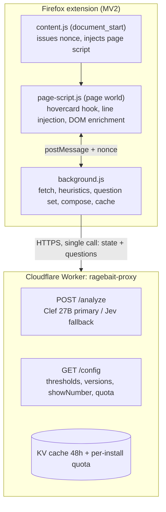

# Ragebait Detector — Plan (Design + Implementation)

Date: 2026-10-12
Authors: berkaykrc + opencode (brainstorming process)

---

# PART 1 — DESIGN

## 1. Purpose and success criteria

A Firefox extension that shows, inside X (Twitter) user hovercards (the popout shown when hovering a username), whether that account carries a **ragebait / engagement-bait** profile. The analysis is based on the account's **replies** — the patterns in what they write under other people's tweets — not on their original posts.

Success criteria:
- Hover → staged render: cache-hit ≤200ms, heuristic sketch ≤1s from page-1 only, page-2 + AI upgrade async (cold miss 2-12s, never blocks first band). Final line format: `Ragebait: High · %87` (color-coded band + calibrated number, number gated behind calibration)
- No paid/API-key burden for end users (developer credits via proxy; users can BYOK or fall back to heuristic-only mode)
- The user's own X session is never used to call X's internal API (ToS / account risk avoidance)
- Open source, development recorded end-to-end, distributable to anyone (AMO-signed xpi)

## 2. Locked decisions (with evidence)

| Topic | Decision | Evidence |
|---|---|---|
| Data source (primary) | FxTwitter public API: `GET api.fxtwitter.com/2/profile/{handle}/statuses?with_replies=true&count=40` + page until ≥5 qualifying replies or cursor exhaustion (cap 3 pages, `cursor.bottom` pagination) | Spike: verified on 10/12 real accounts; returns replies + target account (`replying_to.screen_name`); no auth |
| Data source (deep mode, optional) | `UserByScreenName` (rest_id) → `UserRepliesTimeline` — ONLY with explicit user consent, personal use/opt-in; explicit Phase-5 spike, deferred in v1 | Verified live on 2026-10-10 with the user's session; all fields present (`full_text`, `in_reply_to_screen_name`, `lang`, counters) |
| Data source (enrichment) | DOM: opportunistic collection while user browses the Replies tab via `[data-testid="tweet"]` + `[data-testid="socialContext"]`, merged via DOM-store in Task 8 | X UI behavior verified |
| Dead alternatives | syndication CDN (empty), Nitter (all dead), vxtwitter (403), X GraphQL guest (blocked), `/2/search` (404) | Spike report |
| AI layer | Heuristics (always) + Clef 27B (TypeSafe-compatible endpoint, primary — verify binding before Task 12; Workers AI only if a real `@cf/` model exists) + Jev $5 credit (fallback) | TypeSafe/Cloudflare docs + Turkish benchmark |
| Local model | None in this phase (savasy domain-mismatched, no ONNX build). Later: TurkishBERTweet evaluation | Architecture review |
| Display | Band + side-by-side calibrated number: `Ragebait: High · %87`. Number shown only after held-out calibration gate (ECE ≤0.1 + high precision ≥0.9, Task 18) | User decision |
| Cache | browser.storage.local (7-day TTL) + Worker shared cache (48h); key `ragebait:v1:{modelVersion}:{featureVersion}:{lowerHandle}` | Design |
| Distribution | Public GitHub + AMO "unlisted" signing with `update_url` story (no public listing), MV2 (Firefox primary) + MV3 (compat shim, Task 20) manifests | Mozilla policy |
| License | Apache-2.0 | Consistency with Clef ecosystem |

## 3. Architecture (target)



**Firefox extension (MV2)**

- `content.js` (`document_start`): issues per-injection nonce, injects `page-script.js`, wires `browser.storage.onChanged` to the postMessage bridge.
- `page-script.js` (page world, `SELECTORS` registry):
  - Hovercard hook: `#layers` MutationObserver, `[data-testid="HoverCard"]`, username from `[href$="/following"]` pathname.
  - Line injection (CP4T pattern, `afterend`); selector miss is a silent no-op with console warning.
  - DOM enrichment: Replies-tab scraper feeding the DOM-store.
- `background.js`:
  - Data layer: FxTwitter client behind the `FxDataAdapter` seam, with retry/backoff.
  - Heuristics (lexicon + patterns + ratios), typed question set (5 scored questions, `topic` dropped from the billable call), score composition (placeholder weights pending Task 18).
  - Cache: `browser.storage.local`, 7-day TTL, key `ragebait:v1:{modelVersion}:{featureVersion}:{lowerHandle}`.

**Cloudflare Worker "ragebait-proxy"**

- `POST /analyze` → Clef 27B (primary, endpoint verified in Task 12) with Jev fallback.
- `GET /config` → thresholds, model/feature versions, `showNumber` gate, quota settings.
- KV: shared analysis cache (48h); per-install HMAC token quota with daily limit (429 + degraded mode, never fail-open).
- No logging; no personal data retention.

Communication rules: page ↔ extension via `window.postMessage` with per-injection capability nonce (background-issued token echoed in replies) + origin + strict type allowlist; page-world fields treated as untrusted (handle re-validated, dedupe + rate-limit before any quota-consuming work). Only numeric enums are rendered in the injected line. Same-origin page scripts can forge `origin`, so origin check alone is NOT spoofing protection.

## 4. Data layer (design)

**Primary flow (hover):**
1. Hovercard opens → username read
2. Cache check (local → proxy KV) → if hit, render instantly (≤200ms budget)
3. Miss → FxTwitter: page until ≥5 qualifying replies or cursor exhaustion (cap 3 pages, count=40, page-1 renders heuristic sketch ≤1s, page-2+ async upgrade)
4. Extraction: `author.screen_name === handle && replying_to && replying_to.screen_name !== handle`
5. 404-flakiness: 2-3 retries (exponential backoff 500ms/1s); 429/5xx: respect Retry-After + backoff + degrade. Final mapping: `not_found` after retries → `error` (no data, NO heuristic); transport timeout/5xx/429 → `estimated` heuristic on partial/DOM data; `malformed` → `error` if zero usable replies else partial `estimated`
6. Insufficient data (<5 qualifying replies after cursor exhaustion) → "insufficient data" state

**Per-reply features:** text, language, target account, parent tweet ID, likes/replies/views counters, timestamp.

**Aggregate features (for heuristics + AI state):** reply count; distinct target count; target concentration (share of replies to top-3 targets); repeat replies to same parent (conversation bombing); ALL-CAPS ratio; exclamation/rhetorical-question density; hashtag density; provocation lexicon hits (TR+EN); average engagement per reply; target account size asymmetry (when available); temporal distribution (burst vs steady).

**Deep mode (setting off by default):** after consent, UserByScreenName → UserRepliesTimeline; query IDs from `/config`; the `x-client-transaction-id` signing requirement is tested at this stage and implemented if needed.

## 5. AI layer (design — implemented in Plan 2)

In the Worker proxy, **one call per profile** with parallel questions:
- `is_provocative` (noul) — do the replies carry deliberate anger/provocation
- `is_engagement_bait` (noul) — engagement-farming pattern
- `targets_group_identity` (noul) — group-identity targeting
- `reply_farms_opponents` (noul) — repeated reply-farming under viral accounts
- `intensity` (score: calm / provocative / inflammatory)
- `topic` (choice: politics / religion / football / culture-war / troll / other)

Composition rules (in extension code): weights and thresholds explicit; band thresholds fixed at calibration (initially: High ≥0.75, Medium 0.45–0.75, below is Low — revised at calibration v1). `noul` carries no confidence field; only choice/score do. Noul answers arrive as objects `{noul: 0..1}` — unwrap before math. Composition formula (placeholder pending Task 18, marked as such in code): `score = Σ(w_i * noul_i) / Σ(w_present)` over present answers only (renormalized, never NaN); `intensity` score does NOT multiply in v1 (recorded for calibration buckets only) to keep formula auditable. The raw probability number is displayed ONLY after the calibration report (reliability diagram + ECE on held-out set) is approved.

Calibration set: hand-labeling by the domain expert (user); 50-80 accounts to start (stratified: balanced across topics, OWN SIDE / OPPOSING SIDE balanced — to avoid building a "detects my opponents" model), Krippendorff α report with a second annotator (computed in Task 17, target ≥0.7), precision-first thresholding on tune split, final gate on held-out split with Wilson CIs; growth to 300-500 later.

## 6. UI states (design)

- Format: `Ragebait: {band} · %{number}` (number gated behind held-out calibration); colors: green/yellow/red
- In-flight state: "analyzing…" skeleton + AbortController (cancel when card closes, propagated to background dedupe entry; background work is shared/cancelled when no cards need it); cache hit renders instantly (≤200ms)
- Error states: "analysis failed" (data source failure / not_found), "insufficient data", "estimated (no model)" — heuristic-only result, "quota exceeded — retry tomorrow" (distinct `quota` state)
- Click the line → manual "refresh"; stale indicator (TTL close to expiry: fetchedAt > 5 days on 7-day TTL)
- Settings page: backend mode (proxy/BYOK/heuristic-only), consent, quota display, misclassification report

## 7. Error handling and resilience

| Failure | Behavior |
|---|---|
| FxTwitter `not_found` after retries | `error` state ("analysis failed"), heuristics NOT run (no data) — never "insufficient data" |
| FxTwitter transport timeout/5xx/429, `malformed` with partial data | `estimated` heuristic on partial/DOM data; DOM enrichment continues |
| FxTwitter `malformed` with zero usable replies | `error` state |
| Proxy 429 (quota) | Quota message to user; heuristic-only; retry tomorrow |
| Clef outage/529 | Fallback call to Jev; if that fails, heuristic-only |
| X endpoint/query ID rotation | `/config` hotfix (no AMO re-review); selector registry |
| X DOM changes | Selector registry + CP4T upstream watch; if broken, no line, console warning |
| postMessage spoofing | Per-injection nonce + origin + strict type allowlist; page-world data never triggers privileged/quota-consuming work without re-validation + dedupe; only allowed message types |
| XSS | Every dynamic string in the injected line is escaped/allowlisted (numeric enums + known keywords only) |

## 8. Testing strategy

- **Unit:** parser (using real captured fixtures from the spike session), heuristic features, composition/thresholds, cache TTL/keying
- **Integration:** mocked FxTwitter (recorded fixtures), mocked proxy responses (Clef/Jev shape), retry/timeout behavior
- **Calibration:** precision/recall per band, Krippendorff α, reliability diagram, ECE — tuned on tune split, gated on held-out split (Wilson CIs); threshold report
- **E2E:** web-ext lint; load in Firefox; hovercard test on fixture accounts (yooksiktir, Boogie2988, karanows, etc.)
- **Manual QA matrix:** cache hit/miss, offline, quota exhaustion, FxTwitter flaky-404, DOM change simulation

## 9. Compliance, legal, distribution

- **AMO:** `browser_specific_settings.gecko.data_collection_permissions` declaration (mandatory, verify against current AMO schema — `required`/`optional` technical + `url` for privacy policy), first-run consent screen (ALL modes disclose FxTwitter handle fetch; AI mode additionally discloses "reply texts of analyzed accounts are sent to Cloudflare for AI scoring"), privacy policy
- **GDPR:** tweet text of analyzed third parties is personal data → data minimization (only necessary replies + aggregates), no server-side retention, Cloudflare DPA, FxTwitter as sub-processor disclosure, DSAR path (mailto + doc in Task 19)
- **Defamation risk:** results shown only to the hovering user (NO public lists); "estimated, not definitive" framing; misclassification report path (mailto + template in Task 19)
- **Distribution:** GitHub Releases + AMO unlisted-signed .xpi with `update_url` story so users auto-update; on your own machine, Fedora unbranded build / Nightly + `xpinstall.signatures.required=false` for unsigned persistent install (does NOT work on Release Firefox) (development)
- **Repo layout:** `extension/` (content, page, background, modules, options, _locales), `worker/` (proxy), `data/labeled/` (calibration set), `docs/` (this plan, calibration reports, privacy), CI: web-ext lint + tests

## 10. Out of scope (YAGNI)

- Bundled local model in this phase; multi-device sync; Chrome-first (MV3 manifest ships alongside but Firefox is primary); mobile Firefox; scheduled auto-refresh; user account system; community list sharing

## 11. Open risks (registry)

1. FxTwitter service death/shape change → adapter interface (Task 4 seam) + DOM-enrichment store/merge (Task 8) + deep mode as explicit Phase-5 spike (deferred in v1, accepted risk until then); /config + adapter swap
2. Calibration quality → precision-first on tune split, held-out gate with Wilson CIs, α report (Task 17)
3. Free-tier ceiling (~10k neurons/day total) → phase plan (developer credits → pro plan / BYOK / heuristic-only); quota fail-degraded (stale cache/heuristic + 503, never fail-open unlimited)
4. X DOM/API changes → selector registry fed by `/config` (Task 3) + upstream watch
5. Abuse → per-install HMAC token quota + WAF + install token; worker quota checked before cache/model, `x-quota-remaining` header

---

# PART 2 — IMPLEMENTATION (All Phases)

> **For agentic workers:** REQUIRED SUB-SKILL: Use superpowers:subagent-driven-development (recommended) or superpowers:executing-plans to implement this plan task-by-task. Steps use checkbox (`- [ ]`) syntax for tracking.

**Goal:** A self-contained Firefox extension (heuristic-only mode, no cloud dependency) that shows a ragebait band score in X hovercards based on the target account's replies — then extended with the AI decision-model layer (Clef/Jev via proxy), calibration, and release-ready compliance.

**Architecture:** MV2 extension, CP4T pattern: `content.js` (document_start) → `page-script` (page world) injection; pure logic in ES modules (data/analysis) imported directly by Node tests; esbuild produces `dist/`. Data source is the FxTwitter public API; results cached in `browser.storage.local`.

**Tech Stack:** Vanilla JS (ES modules), esbuild, `node --test`, web-ext. Single external dependency: `api.fxtwitter.com` (HTTP, no auth).

## Global Constraints

- Firefox MV2 manifest; `browser_specific_settings.gecko.id` (use real-domain-style id, confirm AMO accepts — do NOT ship `.local` without verification) and `strict_min_version: "121.0"` (Part 1 §2, §9)
- `permissions: ["storage"]`; host access only via content-script match patterns; `data_collection_permissions` verified against current AMO schema
- v1's only network target: `https://api.fxtwitter.com/*`; NO API keys, NO cloud (AI layer is Plan 2) — but FxTwitter fetch IS off-device disclosure, privacy text must say so
- Reply extraction rule (Part 1 §4): `author.screen_name === handle && replying_to && replying_to.screen_name !== handle`
- 404-flakiness: at least 2 retries (spike: existing accounts get false 404s); 429/5xx respect Retry-After + backoff (Task 4)
- Pagination: page until ≥5 qualifying replies or cursor exhaustion, cap 3 pages (not fixed 2)
- Band thresholds (Part 1 §5): High ≥0.75, Medium 0.45–0.75, below is Low — pre-calibration, shown with "estimated" label; raw % number NOT displayed (gated on held-out ECE ≤0.1 + high precision ≥0.9)
- Cache keys unified: `ragebait:v1:{modelVersion}:{featureVersion}:{lowerHandle}` (never singular `configVersion`)
- All code as ES modules; tests with `node --test` (Node 20+); one commit per task
- Apache-2.0 license

## Review Focus

- **False 404 for an existing account (FxTwitter flakiness):** after retries fail → "analysis failed" state and heuristics NOT run (no data) — never silently "insufficient data" → Task 4 tests + Task 8 integration test
- **Account with <5 replies (e.g. aynenk4nzi):** "insufficient data" shown, no estimate produced → Task 5 test + Task 7 markup test
- **X DOM/hovercard selector change:** no line rendered at all, console warning, page must not break → Task 3 test (selector miss → no-op)
- **Language other than TR/EN (lang field):** lexicon skipped, features null-safe, score still produced → Task 5 test
- **Corrupt/incomplete API response (missing results, missing entry, null replying_to):** parser never throws, returns partial results → Task 4 tests

---

### Task 1: Repo and toolchain

**Files:**
- Create: `package.json`, `esbuild.config.mjs`, `tests/smoke.test.js`

**Interfaces:**
- Produces: `npm test` (node --test), `npm run build` (esbuild → dist/), `npm run lint` (web-ext lint)

- [ ] **Step 1: Write `package.json`**

```json
{
  "name": "ragebait-detector",
  "version": "0.1.0",
  "type": "module",
  "license": "Apache-2.0",
  "scripts": {
    "test": "node --test tests/",
    "build": "node esbuild.config.mjs",
    "lint": "web-ext lint --source-dir dist"
  },
  "devDependencies": {
    "esbuild": "^0.24.0",
    "web-ext": "^8.0.0"
  }
}
```

- [ ] **Step 2: Write `esbuild.config.mjs`** — 4 entry points: `src/content.js`, `src/page/index.js`, `src/background/index.js`, `src/options/index.js`; IIFE bundles written under `dist/` with the same names; copy `src/options/index.html` → `dist/options.html` (esbuild has no HTML copy — explicit copy step).

- [ ] **Step 3: Write `tests/smoke.test.js`** — a `node:test` "toolchain works" test.

- [ ] **Step 4: Run `npm install`** → dependencies installed.

- [ ] **Step 5: Run `npm run build`** → 4 files created in `dist/`.

- [ ] **Step 6: Run `npm test`** → PASS.

- [ ] **Step 7: Commit** — `chore: repo + esbuild/test/lint toolchain`

### Task 2: MV2 manifest and security bridge

**Files:**
- Create: `manifest.mv2.json`, `src/content.js`, `src/page/security.js`, `src/page/inject-config.js`
- Test: `tests/page/security.test.js`

**Interfaces:**
- Produces: `isTrustedRagebaitMessage(event, expectedOrigin, expectedNonce)` → boolean (page→extension spoofing protection via per-injection nonce + origin + type allowlist; same-origin forgery without nonce → false); `parseScoreRequest(data)` → `{handle, nonce}` | `null`; `escapeHtml(str)` → string

- [ ] **Step 1: Write failing tests** — spoof: `event.origin !== location.origin` → false; same-origin forged message without/invalid nonce → false; bad schema (`type` wrong, handle not 1-15 chars, `/` in handle) → null; `escapeHtml('<script>')` → escaped text; handle regex `/^[a-zA-Z0-9_]{1,15}$/` accept/reject examples.

- [ ] **Step 2: Run test** → FAIL (functions don't exist).

- [ ] **Step 3: Implement `src/page/security.js`** — the 3 functions above; handle regex `/^[a-zA-Z0-9_]{1,15}$/`; nonce issued by background per injection, echoed in replies.

- [ ] **Step 4: Run test** → PASS.

- [ ] **Step 5: Write `manifest.mv2.json`** — gecko id (real-domain-style, verify AMO accepts — do NOT ship `.local` unverified; placeholder `ragebait-detector@berkaykrc.local` must be replaced before Task 19), `strict_min_version: "121.0"`, `permissions: ["storage"]`, content scripts `https://x.com/*` + `https://twitter.com/*`, `run_at: document_start`, `web_accessible_resources: ["dist/page.js"]`, background `dist/background.js`, options page at `src/options/index.html`.

- [ ] **Step 6: Write `src/content.js`** — at document_start: inject settings script tag (`<script id="ragebait-config" type="application/json">`), inject `dist/page.js`, wire `browser.storage.onChanged` ↔ postMessage bridge (config changes).

- [ ] **Step 7: Run `npm run lint`** → clean.

- [ ] **Step 8: Commit** — `feat: mv2 manifest + content script + message security`

### Task 3: Hovercard hook and line rendering

**Files:**
- Create: `src/page/hovercard.js`, `src/page/render.js`
- Test: `tests/page/hovercard.test.js`, `tests/page/render.test.js`

**Interfaces:**
- Consumes: `escapeHtml` (Task 2), selector registry (selectors in one config block, overridable via `/config` in Phase 2)
- Produces: `extractScreenName(followingPathname)` → string | null (e.g. `/yoksiktir/following` → `yoksiktir`); `shouldRenderLine($hoverCard)` → boolean; `buildLineMarkup(state)` → HTML string; `BAND_STYLES` → `{ low, medium, high }` CSS color map; `SELECTORS` → `{ layers, hoverCard, avatarContainer, followingLink }`

- [ ] **Step 1: Write failing tests** — `extractScreenName('/yoksiktir/following')` → `'yoksiktir'`; `/following` → null; `null` → null; `buildLineMarkup({state:'loading'})` → contains "analyzing…"; `{state:'result', band:'high', percent:null}` → "Ragebait: High" + "estimated" + red class; `{state:'insufficient'}` → "insufficient data"; `{state:'error'}` → "analysis failed"; `{state:'quota'}` → "quota exceeded"; a band value containing `<b>` is escaped; selector miss → no-op + console warning.

- [ ] **Step 2: Run test** → FAIL.

- [ ] **Step 3: Implement** — `hovercard.js`: MutationObserver on `#layers` (from `SELECTORS`, childList); if an added node contains `[data-testid="HoverCard"]` → wait for `div[data-testid^="UserAvatar-Container"]` (rAF poll, 500ms timeout) → username from `[href$="/following"]` pathname → `render.js` adds the line (`insertAdjacentHTML('afterend', …)`, CP4T insertion point: 3rd parent of `[href$="/following"]`). Selector miss → silent no-op + console warning, page never breaks.

- [ ] **Step 2: Run test** → FAIL.

- [ ] **Step 3: Implement** — `hovercard.js`: MutationObserver on `#layers` (childList); if an added node contains `[data-testid="HoverCard"]` → wait for `div[data-testid^="UserAvatar-Container"]` (rAF poll, 500ms timeout) → username from `[href$="/following"]` pathname → `render.js` adds the line (`insertAdjacentHTML('afterend', …)`, CP4T insertion point: 3rd parent of `[href$="/following"]`). Selector miss → silent no-op.

- [ ] **Step 4: Run test** → PASS.

- [ ] **Step 5: `npm run build`** + commit — `feat: hovercard detection + line rendering (static states)`

### Task 4: FxTwitter client and reply extractor

**Files:**
- Create: `src/data/fxtwitter.js`, `src/data/parse.js`
- Create (fixtures): `tests/fixtures/fxtwitter-yoksiktir.json`, `tests/fixtures/fxtwitter-boogie2988.json`
- Test: `tests/data/parse.test.js`, `tests/data/fxtwitter.test.js`

**Interfaces:**
- Produces: `extractProfileReplies(responseJson, handle)` → `Reply[]` (Reply: `{id, text, lang, targetScreenName, parentStatusId, likes, replyCount, views, createdAt}`); `fetchReplies(handle, {fetchImpl, sleepImpl, maxPages=3, count=40})` → `{ok: true, replies} | {ok:false, reason:'not_found'|'network'|'rate_limit'|'malformed'}`; `FxDataAdapter` seam (interface both FxTwitter client and future DOM/deep-mode sources implement, so SPOF swap needs no orchestration rewrite)

- [ ] **Step 1: Save fixtures** — `fxtwitter-yoksiktir.json`: a `{"code":200,"results":[…]}` array containing yooksiktir's reply `"@kviciemre knkk bak kullanamıyoruz seslide amk ya"` (`author.screen_name:"yoksiktir"`, `replying_to.screen_name:"kviciemre"`) plus mixed content (another user's reply, an original post, a record with `replying_to:null`). `fxtwitter-boogie2988.json`: the TheRayFlexer reply (foreign author) + at least 1 Boogie2988 own reply.

- [ ] **Step 2: Write failing parse tests** — from the fixture: only records with `author.screen_name === handle` AND non-null `replying_to` AND `replying_to.screen_name !== handle` are returned; in the yooksiktir fixture exactly 1 record, target `kviciemre`, full text, lang `tr`; empty `results`, missing `results`, null `replying_to`, missing `legacy`/`author` fields → partial/empty array, NO exception.

- [ ] **Step 3: Run parse test** → FAIL.

- [ ] **Step 4: Implement `parse.js`** — the rule above + partial tolerance (missing optional fields → `null`).

- [ ] **Step 5: Run parse test** → PASS.

- [ ] **Step 6: Write failing fxtwitter tests** — fake `fetchImpl`: (a) first call 404+`{"code":404}`, second 200 → `ok:true` (flaky retry); (b) 3× 404 → `ok:false, reason:'not_found'`; (c) assert `count=40&with_replies=true` URL and cursor-based paging until ≥5 qualifying replies or cursor exhaustion (cap 3 pages), cursor-missing terminates; (d) network throw → `ok:false,'network'`; (e) 200 + broken JSON → `'malformed'`; (f) 429 → `'rate_limit'` with Retry-After respect; (g) 5xx → backoff then `'network'`.

- [ ] **Step 7: Run test** → FAIL.

- [ ] **Step 8: Implement `fxtwitter.js`** — URL: `https://api.fxtwitter.com/2/profile/${handle}/statuses?with_replies=true&count=40` (+ `&cursor=` for page 2+); on 404 retry twice with 500ms/1s backoff; on 429/5xx respect Retry-After + exponential backoff; `sleepImpl` injected (test speed); results merged with `extractProfileReplies`; expose via `FxDataAdapter` interface.

- [ ] **Step 9: Run test** → PASS.

- [ ] **Step 10: Commit** — `feat: fxtwitter client + reply extractor (real fixtures)`

### Task 5: Heuristic features and score composition

**Files:**
- Create: `src/analysis/lexicon.js`, `src/analysis/features.js`, `src/analysis/compose.js`
- Test: `tests/analysis/features.test.js`, `tests/analysis/compose.test.js`

**Interfaces:**
- Produces: `computeFeatures(replies)` → `{replyCount, distinctTargets, targetConcentration, repeatParentRatio, capsRatio, rhetoricalQuestionRatio, hashtagDensity, lexiconHits, likesPerReply}`; `composeScore(features)` → `{score: number 0-1, band: 'low'|'medium'|'high', heuristic: true}` | `{insufficient: true}`

- [ ] **Step 1: Write lexicon** (`lexicon.js`) — starter TR+EN lexicon (provocation/mockery: "öl ya", "amk", "troller", "muhalif", "angry", "cope", "ratio", "L take", ...; at least 25 entries; whole-word match, case-insensitive; note: Turkish agglutination will under-match — stemming/substring policy revisited at calibration, Task 18).

- [ ] **Step 2: Write failing features tests** — capsRatio: "LAN BU NE" / 3 → 1.0; rhetorical question: share of sentences ending "?"; hashtagDensity: "#x #y" / 4 words; targetConcentration: 100% concentration on 3 targets → 1.0; repeatParent: same parentId 3× → 1.0; lexiconHits: "amk" and "cope" → 2; `replyCount<5` → skip computation (insufficient).

- [ ] **Step 3: Run test** → FAIL.

- [ ] **Step 4: Implement `features.js`** — Reply[] → feature vector; if lang is outside TR/EN the lexicon is skipped (`lexiconHits: null`) and other features still computed.

- [ ] **Step 5: Run test** → PASS.

- [ ] **Step 6: Write failing compose tests** — all features high (capsRatio 1, rhetorical 1, concentration 1, high lexicon hits) → `band:'high'`, `score≥0.75`; low features → `band:'low'`; boundary: exactly 0.75 → high; `{replyCount:4}` → `{insufficient:true}`; `lexiconHits:null` (non-TR/EN) → score still produced.

- [ ] **Step 7: Run test** → FAIL.

- [ ] **Step 8: Implement `compose.js`** — documented initial weights PLACEHOLDER pending Task 18 (e.g. lexicon 0.25, caps 0.15, rhetorical 0.15, concentration 0.15, repeatParent 0.15, engagement 0.15 — must be marked placeholder in code, never enshrined); `lexiconHits:null` (non-TR/EN) renormalizes: `score = Σ(w_present * f_present) / Σ(w_present)`; `MIN_REPLIES = 5` (Part 1 §4, qualifying replies after cursor exhaustion).

- [ ] **Step 9: Run test** → PASS.

- [ ] **Step 10: Commit** — `feat: heuristic features + band scoring`

### Task 6: Local cache

**Files:**
- Create: `src/data/cache.js`
- Test: `tests/data/cache.test.js`

**Interfaces:**
- Produces: `createCache({storage, now, modelVersion, featureVersion})` → `{get(handle), set(handle,result)}`; TTL 7 days; key `ragebait:v1:{modelVersion}:{featureVersion}:{lowerHandle}` (lower-cased, X handles case-insensitive)

- [ ] **Step 1: Write failing tests** — set→get roundtrip; a record 7 days + 1 second old → null; different `modelVersion` or `featureVersion` → null; case-variant handle hits same entry; corrupt JSON value → null (no throw); storage that throws → silent null.

- [ ] **Step 2: Run test** → FAIL.

- [ ] **Step 3: Implement `cache.js`** — `Map` front cache + storage adapter (prod: `browser.storage.local`, test: fake); `get` order: memory → storage; TTL check via injected `now()`.

- [ ] **Step 4: Run test** → PASS.

- [ ] **Step 5: Commit** — `feat: browser.storage cache (7d TTL, version-keyed)`

### Task 7: Hovercard UI states (live flow)

**Files:**
- Create: `src/page/messaging.js`
- Modify: `src/page/render.js` (state transitions), `src/page/hovercard.js` (AbortController)
- Test: `tests/page/render-states.test.js`

**Interfaces:**
- Produces: state factories for `STATE_MARKUP` (loading/result/insufficient/error/quota/stale); `applyState($line, state)`; in-flight request aborted via `AbortController.abort()` when the card is removed, propagated to background (shared work cancelled when no cards need it)

- [ ] **Step 1: Write failing tests** — loading→result transition: after `applyState`, markup contains the band with "estimated" label; result→(refresh)→loading transition; stale indicator (fetchedAt > 5 days); band color classes; `quota` state shows "quota exceeded — retry tomorrow" + heuristic note.

- [ ] **Step 2: Run test** → FAIL.

- [ ] **Step 3: Implement** — `render.js`: state machine (loading/result/insufficient/error/quota/stale); `hovercard.js`: MutationObserver watches card removal from DOM → abort + message to background to release dedupe entry; click line → refresh event (message to background).

- [ ] **Step 2: Run test** → FAIL.

- [ ] **Step 3: Implement** — `render.js`: state machine (loading/result/insufficient/error/stale); `hovercard.js`: MutationObserver watches card removal from DOM → abort + cancel request; click line → refresh event (message to background).

- [ ] **Step 4: Run test** → PASS.

- [ ] **Step 5: `npm run build`** + commit — `feat: hovercard state machine + cancel + refresh`

### Task 8: Background orchestration

**Files:**
- Create: `src/background/index.js`, `src/background/protocol.js`
- Test: `tests/background/orchestration.test.js`

**Interfaces:**
- Consumes: `fetchReplies` (Task 4), `computeFeatures`, `composeScore` (Task 5), `createCache` (Task 6), `isTrustedRagebaitMessage`, `parseScoreRequest` (Task 2)
- Produces: `handleScoreRequest(handle, deps)` → `Promise<Result>`; `MAX_DAILY_PROFILES = 200` (local soft limit)

- [ ] **Step 1: Write failing tests** (fake fetchImpl/storage/messaging, end-to-end): (a) cache hit → NO network call, result returned; (b) miss → fxtwitter 200 → features → compose → cache.set → result `{band, heuristic:true}`; (c) fxtwitter not_found → `{state:'error'}` (NO heuristic fallback — Review Focus); (d) <5 replies → `{state:'insufficient'}`; (e) same handle twice back-to-back (in-flight dedupe) → ONE network call; (f) daily limit exceeded → `{state:'quota'}`; (g) corrupt handle → rejected; (h) latency: page-1 heuristic sketch resolves ≤1s on mocked miss (staged budget, Part 1 §1).

- [ ] **Step 2: Run test** → FAIL.

- [ ] **Step 3: Implement `background/index.js`** — message listener (nonce + trust check) → dedupe Map (shared, cancellable) → cache (`lowerHandle`) → fxtwitter via `FxDataAdapter` → DOM-store merge (opportunistic Replies-tab data) → features → compose → cache.set → response; `protocol.js`: request/response schema constants (incl. `quota` state).

- [ ] **Step 4: Run test** → PASS.

- [ ] **Step 5: Run `npm run lint`, `npm test`, `npm run build`** → all pass.

- [ ] **Step 6: Commit** — `feat: background orchestration (cache+fetch+score)`

### Task 9: Settings page

**Files:**
- Create: `src/options/index.html`, `src/options/index.js`
- Test: `tests/options/settings.test.js`

**Interfaces:**
- Produces: `loadSettings(storage)`, `saveSettings(storage, settings)`; fields: `mode: 'heuristic'` (fixed in v1), `consentAccepted: boolean`, `showPercent: boolean` (calibration gate, false in v1)

- [ ] **Step 1: Write failing tests** — defaults; save→load roundtrip; corrupt record → defaults.

- [ ] **Step 2: Run test** → FAIL.

- [ ] **Step 3: Implement options page** — mode selector (heuristic active, proxy/BYOK marked "Plan 2"), consent text (ALL modes: FxTwitter handle fetch leaves device; AI mode additionally uploads reply text to Cloudflare — v1 text: data stays on device except FxTwitter fetch, NO Cloudflare), quota/stats display (number of profiles analyzed).

- [ ] **Step 4: Run test** → PASS.

- [ ] **Step 5: `npm run build`** + commit — `feat: settings page`

### Task 10: Packaging, documentation, release

**Files:**
- Create: `README.md`, `docs/qa/manual-matrix.md`, `LICENSE`

- [ ] **Step 1: Write `README.md`** — project description, install (dev: `npm install && npm run build`; load into Firefox Nightly/Unbranded: `about:config` → `xpinstall.signatures.required=false` → install from dist zip; does NOT work on Release Firefox), privacy summary (FxTwitter disclosure in all modes + Cloudflare in AI mode), contribution guide, roadmap (Plan 2: AI layer; Plan 3: calibration).

- [ ] **Step 2: Write `docs/qa/manual-matrix.md`** — QA matrix (Part 1 §8): cache hit/miss (+ ≤200ms hit check), offline, flaky-404 simulation (force fetch 3× 404 → `error`, not `insufficient`), transport-error simulation (5xx/timeout → `estimated`), quota exhaustion (local + worker → `quota` copy), staged latency (page-1 sketch ≤1s on cold miss), DOM change (break selectors → no line + console warning), <5-reply account, non-TR/EN account.

- [ ] **Step 3: `LICENSE`** — Apache-2.0 text.

- [ ] **Step 4: Final verification** — `npm test`, `npm run lint`, `npm run build` all pass; `web-ext build` produces `web-ext-artifacts/` (gitignored).

- [ ] **Step 5: Commit + tag** — `release: v0.1.0-alpha (heuristic mode)` and `git tag v0.1.0-alpha`.

---

## Phases and task map

| Phase | Tasks | Deliverable |
|---|---|---|
| 0-1: Extension core | 1-10 | Working heuristic-only extension |
| 2: AI layer | 11-15 | Worker proxy (Clef+Jev) + AI scoring in extension |
| 3: Calibration | 16-18 | Labeled set, reliability report, % number enabled |
| 4: Compliance + release | 19-21 | AMO submission, signed release |

### Task 11: Worker proxy scaffold and /config

**Files:**
- Create: `worker/package.json`, `worker/wrangler.toml`, `worker/src/config.js`, `worker/src/index.js`
- Test: `worker/tests/config.test.js`

**Interfaces:**
- Produces: `GET /config` → `{ modelVersion, featureVersion, bandThresholds: {high, medium}, queryIds: {...}, showNumber: boolean, proxyEnabled: boolean }`; `buildConfig(env)` → config object; fetch router skeleton

- [ ] **Step 1: Write failing tests** — `buildConfig` returns spec band thresholds (high 0.75, medium 0.45); `featureVersion` bump invalidates client cache keys; missing env → safe defaults (proxyEnabled false).

- [ ] **Step 2: Run test** → FAIL.

- [ ] **Step 3: Implement `worker/src/config.js` + `wrangler.toml`** (KV namespace binding, env vars for API keys — keys ONLY in worker env, never in the extension).

- [ ] **Step 4: Run test** → PASS.

- [ ] **Step 5: Implement `worker/src/index.js`** — fetch router: `GET /config` → config JSON; unknown route → 404.

- [ ] **Step 6: Commit** — `feat(worker): scaffold + /config endpoint`

### Task 12: /analyze with Clef 27B and Jev fallback

**Files:**
- Create: `worker/src/analyze.js`, `worker/src/questions.js`
- Test: `worker/tests/analyze.test.js`

**Interfaces:**
- Consumes: design §5 question set
- Produces: `POST /analyze` (body: `{state, questions}`) → normalized `{answers, model}`; `buildQuestionSet(features, sampleReplies)` → the 5 scored questions (4 noul + 1 intensity score; `topic` choice dropped from billable call — recorded only as calibration-bucket metadata offline, not paid inference); `callClef(payload, env, fetchImpl)` / `callJev(payload, env, fetchImpl)`

- [ ] **Step 1: Write `questions.js`** — exact question instructions/criteria per design §5 (is_provocative, is_engagement_bait, targets_group_identity, reply_farms_opponents nouls; intensity score [calm, provocative, inflammatory]). `topic` is NOT sent to the model (cost); if needed later, wire per-topic calibration buckets offline.

- [ ] **Step 2: Write failing tests** — mocked fetch: (a) Clef success → 200 + answers passthrough + `model: "clef"`; (b) Clef 529/5xx → Jev called, response tagged `model: "jev"`; (c) both fail → 502 `{error:"ai_unavailable"}`; (d) malformed body → 400; (e) question payload contains the 5 question ids with correct types (`topic` absent); (f) noul answers verified as `{noul:…}` objects unwrapped before use.

- [ ] **Step 3: Run test** → FAIL.

- [ ] **Step 4: Implement `analyze.js`** — Step 0 before code: verify Clef endpoint/binding (TypeSafe-compatible host vs Workers AI `ai.run` binding; do NOT hardcode `@cf/cloudflare/clef` unverified). Jev fallback to `https://api.typesafe.ai/v1/systemone` (Bearer from env), exponential backoff on 529.

- [ ] **Step 5: Run test** → PASS.

- [ ] **Step 6: Commit** — `feat(worker): /analyze with Clef 27B + Jev fallback`

### Task 13: KV shared cache and per-install quota

**Files:**
- Create: `worker/src/cache.js`, `worker/src/quota.js`
- Test: `worker/tests/cache.test.js`, `worker/tests/quota.test.js`

**Interfaces:**
- Produces: `getCachedAnalysis(kv, key)` / `setCachedAnalysis(kv, key, value, ttlHours=48)`; `checkAndConsumeQuota(kv, installToken, dailyLimit)` → `{allowed: boolean, remaining: number}`; quota key `quota:{installToken}:{YYYY-MM-DD}`; cache key `sha256(lowerHandle + modelVersion + featureVersion)`

- [ ] **Step 1: Write failing tests** — cache roundtrip via fake KV; TTL set in seconds; quota: first call allowed, 3rd call with limit 2 → 429 with remaining 0; different day → resets; quota KV failure → fail-degraded (serve stale cache/heuristic + 503 with Retry-After + alert, never fail-open unlimited inference) so abuse ceiling (~10k neurons/day) holds.

- [ ] **Step 2: Run test** → FAIL.

- [ ] **Step 3: Implement** — fake-KV-injectable modules; cache key = `sha256(lowerHandle + modelVersion + featureVersion)` (lower-cased, feature-aware).

- [ ] **Step 4: Run test** → PASS.

- [ ] **Step 5: Wire into `index.js`** — `/analyze` checks quota first, then cache, then model call; `x-quota-remaining` response header.

- [ ] **Step 6: Commit** — `feat(worker): KV cache + per-install daily quota`

### Task 14: Extension AI client

**Files:**
- Create: `src/ai/client.js`, `src/ai/map-response.js`
- Test: `tests/ai/client.test.js`, `tests/ai/map-response.test.js`

**Interfaces:**
- Consumes: `/config` thresholds (Tasks 11), features (Task 5), settings mode
- Produces: `fetchConfig(proxyUrl, fetchImpl)`; `analyzeWithAi(state, questions, {mode, proxyUrl, byokEndpoint, apiKey}, fetchImpl)` → `{band, percent, model} | {fallback: 'heuristic'}`; `mapNoulToScore(answers, thresholds)` → `{score, band}` (weighted noul composition PLACEHOLDER pending Task 18: is_provocative 0.3, is_engagement_bait 0.3, targets_group_identity 0.2, reply_farms_opponents 0.2; formula `score = Σ(w_i * noul_i) / Σ(w_present)` over present `{noul}`-unwrapped answers only; intensity recorded, NOT a multiplier in v1)

- [ ] **Step 1: Write failing tests** — (a) noul objects `{noul:0.9},{noul:0.8},{noul:0.2},{noul:0.1}` + thresholds → score 0.57 → band medium (correct math, NOT 0.62); (b) all 1.0 → score 1.0 → high; (c) missing noul answer → treated as absent (renormalized weights), never NaN; (d) mode 'heuristic' → no network; (e) mode 'byok' → calls byokEndpoint with apiKey header; (f) proxy 429 → `{fallback:'heuristic'}`; (g) `/config` thresholds come from server (not hardcoded).

- [ ] **Step 2: Run test** → FAIL.

- [ ] **Step 3: Implement** — client with 10s timeout; config cached in `browser.storage.local` for 24h.

- [ ] **Step 4: Run test** → PASS.

- [ ] **Step 5: Commit** — `feat: AI client (proxy/BYOK/heuristic modes) + response mapping`

### Task 15: Band score end-to-end + calibrated number gate

**Files:**
- Modify: `src/background/index.js` (orchestration adds AI step), `src/page/render.js` (number display)
- Test: `tests/background/orchestration-ai.test.js`, `tests/page/render-number.test.js`

**Interfaces:**
- Consumes: analyzeWithAi (Task 14), composeScore (Task 5), /config showNumber flag (Task 11)
- Produces: orchestration returns `{state:'result', band, percent: number|null}` — percent set ONLY when config.showNumber true; markup shows `Ragebait: High · %87` when percent present, `Ragebait: High (estimated)` otherwise

- [ ] **Step 1: Write failing tests** — AI success + showNumber false → percent null, "estimated" label; AI success + showNumber true → percent rendered to 0 decimals; AI fallback → heuristic score with "estimated"; AI error → error state.

- [ ] **Step 2: Run test** → FAIL.

- [ ] **Step 3: Implement** — background: cache → fxtwitter → features → compose (heuristic band instant) → AI call → merge; render per config gate.

- [ ] **Step 4: Run test** → PASS.

- [ ] **Step 5: Commit** — `feat: end-to-end AI scoring with calibration-gated number`

### Task 16: Calibration data collection

**Files:**
- Create: `scripts/collect-calibration.mjs`, `data/labeled/accounts.jsonl` (user-filled), `data/labeled/dataset.jsonl` (generated)
- Test: `tests/calibration/collect.test.js`

**Interfaces:**
- Consumes: `fetchReplies` (Task 4), `computeFeatures` (Task 5)
- Produces: `collectDataset(accountLines, deps)` → dataset rows `{handle, label, features, replySample: string[]}`; skips handles with <5 replies; idempotent (re-run replaces rows); stratified split written: `dataset-tune.jsonl` / `dataset-heldout.jsonl` (e.g. 70/30, stratified by label+topic)

- [ ] **Step 1: Write `data/labeled/accounts.jsonl` format doc** — one JSON per line: `{"handle":"...","label":"ragebait|normal|ambiguous","note":"...","topic":"politics|religion|football|culture-war|troll|other"}`; user fills this file (50-80 accounts, stratified + own-side/opposing-side balanced per design §5).

- [ ] **Step 2: Write failing tests** — with fake fetch (recorded fixtures): rows produced for valid accounts; <5-reply account skipped with logged skip; malformed JSONL line → skipped, no crash; re-run produces identical output; split preserves label ratios.

- [ ] **Step 1: Write `data/labeled/accounts.jsonl` format doc** — one JSON per line: `{"handle":"...","label":"ragebait|normal|ambiguous","note":"..."}`; user fills this file (50-80 accounts, stratified + own-side/opposing-side balanced per design §5).

- [ ] **Step 2: Write failing tests** — with fake fetch (recorded fixtures): rows produced for valid accounts; <5-reply account skipped with logged skip; malformed JSONL line → skipped, no crash; re-run produces identical output.

- [ ] **Step 3: Run test** → FAIL.

- [ ] **Step 4: Implement `scripts/collect-calibration.mjs`** — reads accounts.jsonl, fetches replies (same client), computes features, writes dataset.jsonl + a small reply sample per row; rate-limited politely (500ms between accounts).

- [ ] **Step 5: Run test** → PASS.

- [ ] **Step 6: Commit** — `feat(calibration): dataset collection script`

### Task 17: Calibration evaluation harness

**Files:**
- Create: `scripts/evaluate-calibration.mjs`
- Test: `tests/calibration/evaluate.test.js`

**Interfaces:**
- Consumes: dataset-tune.jsonl + dataset-heldout.jsonl (Task 16), band thresholds from /config shape (Task 11), second-annotator labels for α
- Produces: `evaluate(dataset, thresholds)` → `{perBand: {precision, recall, support}, confusion, ece, reliabilityBuckets, wilsonCI, krippendorffAlpha}`; writes report to `docs/calibration/report-<date>.md`

- [ ] **Step 1: Write failing tests** — synthetic dataset (20 rows, known labels, known scores) → precision for high band ≥ threshold on synthetic construction; calibration error (ECE) in [0,1]; confusion matrix sums to row totals; Wilson CI present; α computed on double-labeled subset.

- [ ] **Step 2: Run test** → FAIL.

- [ ] **Step 3: Implement `evaluate-calibration.mjs`** — for each row: compose score + (if AI available) model probability; per-band precision/recall; reliability buckets (10 bins, predicted vs empirical); ECE; Wilson CIs; Krippendorff α (target ≥0.7); writes markdown report.

- [ ] **Step 1: Write failing tests** — synthetic dataset (20 rows, known labels, known scores) → precision for high band ≥ threshold on synthetic construction; calibration error (ECE) in [0,1]; confusion matrix sums to row totals.

- [ ] **Step 2: Run test** → FAIL.

- [ ] **Step 3: Implement `evaluate-calibration.mjs`** — for each row: compose score + (if AI available) model probability; per-band precision/recall; reliability buckets (10 bins, predicted vs empirical); ECE; writes markdown report.

- [ ] **Step 4: Run test** → PASS.

- [ ] **Step 5: Commit** — `feat(calibration): evaluation harness (precision/recall/ECE/reliability)`

### Task 18: Threshold tuning and number gate flip

**Files:**
- Modify: `worker/src/config.js` (thresholds from tuning), docs/calibration report
- Test: `worker/tests/threshold-tuning.test.js`

**Interfaces:**
- Produces: `pickHighThreshold(tuneScores, tuneLabels, minPrecision=0.9)` → threshold where high-band precision ≥ 0.9 with max recall ON TUNE SPLIT; gate evaluated ON HELD-OUT SPLIT; tuning writes thresholds into `/config` and flips `showNumber: true` ONLY if held-out ECE ≤ 0.1 and held-out high-band precision ≥ 0.9 (with Wilson CIs reported)

- [ ] **Step 1: Write failing tests** — synthetic scores where threshold 0.8 gives precision 0.92/recall 0.5, 0.7 gives 0.85/0.7 → picks 0.8 on tune; held-out gate: passing held-out → showNumber true; failing held-out → showNumber stays false even if tune passed; no threshold meets 0.9 → showNumber stays false.

- [ ] **Step 1: Write failing tests** — synthetic scores where threshold 0.8 gives precision 0.92/recall 0.5, 0.7 gives 0.85/0.7 → picks 0.8; no threshold meets 0.9 → showNumber stays false.

- [ ] **Step 2: Run test** → FAIL.

- [ ] **Step 3: Implement** — precision-first selection; gate logic with explicit reasons written into the report.

- [ ] **Step 4: Run test** → PASS.

- [ ] **Step 5: Commit** — `feat(calibration): precision-first threshold tuning + number gate`

### Task 19: Compliance — AMO declaration, consent UI, privacy policy

**Files:**
- Modify: `manifest.mv2.json` (+ mv3 in Task 20), `src/options/index.html`, `src/options/index.js`
- Create: `docs/privacy-policy.md`
- Test: `tests/compliance/manifest.test.js`, `tests/compliance/consent.test.js`

**Interfaces:**
- Produces: manifest `browser_specific_settings.gecko.data_collection_permissions` (exact object verified against current AMO schema, with privacy-policy `url`); consent state persisted; first-run consent gate blocking AI mode until accepted (heuristic mode discloses FxTwitter fetch — consent text covers it; AI-mode text additionally covers Cloudflare upload)

- [ ] **Step 1: Write failing tests** — manifest JSON contains data_collection_permissions object matching AMO schema; consent: not accepted → AI mode blocked with reason; accepted → allowed; heuristic mode shows FxTwitter disclosure (never claims "nothing leaves device").

- [ ] **Step 2: Run test** → FAIL.

- [ ] **Step 3: Implement** — manifest declaration, consent screen copy (ALL modes: "analyzed handles + reply fetches go to api.fxtwitter.com"; AI mode adds "reply texts of analyzed accounts are sent to Cloudflare for AI scoring"), `docs/privacy-policy.md` (GDPR: minimization, no retention, Cloudflare DPA + FxTwitter sub-processor, DSAR via mailto + doc, "estimated not definitive" defamation framing, misclassification report via mailto + template).

- [ ] **Step 4: Run test** → PASS.

- [ ] **Step 5: Commit** — `feat(compliance): data_collection_permissions + consent UI + privacy policy`

### Task 20: MV3 manifest and dual build

**Files:**
- Create: `manifest.mv3.json`
- Modify: `esbuild.config.mjs`, `.gitignore`
- Test: `tests/build/dual-manifest.test.js`

**Interfaces:**
- Produces: both manifests build cleanly; build script emits `dist-mv2/` and `dist-mv3/`; MV3 uses `background.service_worker` + `action` + MV3 `web_accessible_resources` syntax + `chrome.*` compat shim (MV2 background page state like in-flight Map does NOT survive SW lifecycle — persist or rehydrate)

- [ ] **Step 1: Write failing test** — build produces both dist dirs with correct manifest inside each; manifests differ in background/service_worker, action, web_accessible_resources, `browser`/`chrome` usage; SW persistence test (in-flight request survives SW restart or fails gracefully).

- [ ] **Step 2: Run test** → FAIL.

- [ ] **Step 3: Implement `manifest.mv3.json`** + build split + compat shim (`browser`→`chrome` fallback, SW-safe dedupe).

- [ ] **Step 2: Run test** → FAIL.

- [ ] **Step 3: Implement `manifest.mv3.json`** + build split.

- [ ] **Step 4: Run test** → PASS; `npm run lint` on both.

- [ ] **Step 5: Commit** — `feat: MV3 manifest + dual build (Firefox MV2 primary)`

### Task 21: Release — signing and distribution

**Files:**
- Modify: `README.md` (install section), `docs/release.md`

- [ ] **Step 1: Write `docs/release.md`** — exact steps: `npm run build` → `web-ext build` → `web-ext sign --api-key=$AMO_KEY --api-secret=$AMO_SECRET` (keys from user's AMO account, never committed; unlisted channel with `update_url` so installs auto-update) → signed xpi → GitHub Releases; dev-install note (Nightly/Unbranded only: `about:config` → `xpinstall.signatures.required=false`).

- [ ] **Step 2: Update `README.md`** — user-facing install from GitHub Releases + privacy summary (FxTwitter in all modes, Cloudflare in AI mode) + roadmap.

- [ ] **Step 2: Update `README.md`** — user-facing install from GitHub Releases + privacy summary + roadmap.

- [ ] **Step 3: Final full verification** — `npm test`, `npm run lint`, `npm run build` (both manifests), `node scripts/evaluate-calibration.mjs` runs on current dataset.

- [ ] **Step 4: Commit + tag** — `release: v1.0.0` and `git tag v1.0.0`.

---

## Appendix A — Session evidence (self-contained; no chat needed)

### A.1 FxTwitter public API (primary data source)
- `GET https://api.fxtwitter.com/2/profile/{handle}/statuses?with_replies=true&count=40`
- Pagination: response `cursor.bottom` → `&cursor=<value>` (page 2+)
- Reply filter: `author.screen_name === handle && replying_to && replying_to.screen_name !== handle`
- Response shape: `{code, results: [...], cursor: {top, bottom}}`; reply fields: `text`, `lang`, `author.screen_name`, `replying_to.screen_name`, `likes`, `replies`, `views`, `created_timestamp`
- Flaky 404s for existing accounts → retry 2-3×
- Doc'd rate limit 1000 req/min/IP; no auth

### A.2 X internal GraphQL (deep mode only, consent-gated, personal use)
- `UserByScreenName`: `/i/api/graphql/AMIBMjtxEEATh4z8V9GtRg/UserByScreenName?variables={"screen_name":...}` → `data.user.result.rest_id`
- `UserRepliesTimeline`: `/i/api/graphql/X9Te-FyiGcoV2qNrnx9w3w/UserRepliesTimeline` → `data.user.result.timeline.timeline.instructions[].entries[].content.items[].item.itemContent.tweet_results.result`; reply fields: `legacy.full_text`, `legacy.in_reply_to_screen_name`, `legacy.lang`, `core.user_results.result.core.screen_name`; skip injected modules via `clientEventInfo.details.timelinesDetails.injectionType === "RankedOrganicTweet"`
- Headers: public bearer token, `x-csrf-token` from `ct0` cookie, `x-twitter-auth-type: OAuth2Session`, `credentials: 'include'`; real client also sends `x-client-transaction-id` (generate if required — test at implementation)

### A.3 Clef / Jev API contract (identical shape)
- `POST {base}/v1/systemone` — Jev base `https://api.typesafe.ai`, model `jev-latest`; Clef via TypeSafe-compatible endpoint (verify exact host/model before Task 12 — do NOT assume `https://api.cloudflare.com/client/v4/accounts/{id}/ai/run/@cf/cloudflare/clef` exists; Workers AI only if a real `@cf/` model/binding is confirmed, else Clef-flash 9B as second fallback)
- Body: `{state, model, questions: {id: {type: "noul"|"choice"|"score", instructions, criteria}}}`
- Answers: noul → `{noul: 0..1}` (NO confidence, unwrap before math); choice → `{choice, probabilities, confidence}`; score → `{score, legend, probabilities, confidence}`
- Errors: 401/422/429/529 → backoff; Jev $5 credit; Clef free tier ~10k neurons/day (~0.46M input tokens on 27B) TOTAL across users
- Turkish benchmark (community): Clef 27B 93.8% > Jev 92.9% > Clef-flash 84.7%

### A.4 Hovercard injection (CP4T-verified pattern)
- Repo: github.com/insin/control-panel-for-twitter (MIT) — selectors: `#layers` observer → `[data-testid="HoverCard"]` → wait `div[data-testid^="UserAvatar-Container"]` (rAF poll 500ms) → username from `[href$="/following"]` pathname → line inserted after 3rd parent of that anchor via `insertAdjacentHTML('afterend', …)`
- Two-world split: content.js (document_start) → page script via web_accessible_resources; postMessage + storage bridge
- MV2 viable on Firefox AMO (no deprecation); Chrome MV2 dead (Aug 2026) → ship both manifests

### A.5 Calibration corpus (to be filled by domain expert)
- `data/labeled/accounts.jsonl`: `{"handle","label":"ragebait|normal|ambiguous","topic":"politics|religion|football|culture-war|troll|other","note"}` — 50-80 accounts to start, topic-stratified, own-side/opposing-side balanced; second annotator double-labels a subset → Krippendorff α computed in Task 17, target ≥0.7; collection script writes `dataset-tune.jsonl` / `dataset-heldout.jsonl` (Task 16)
