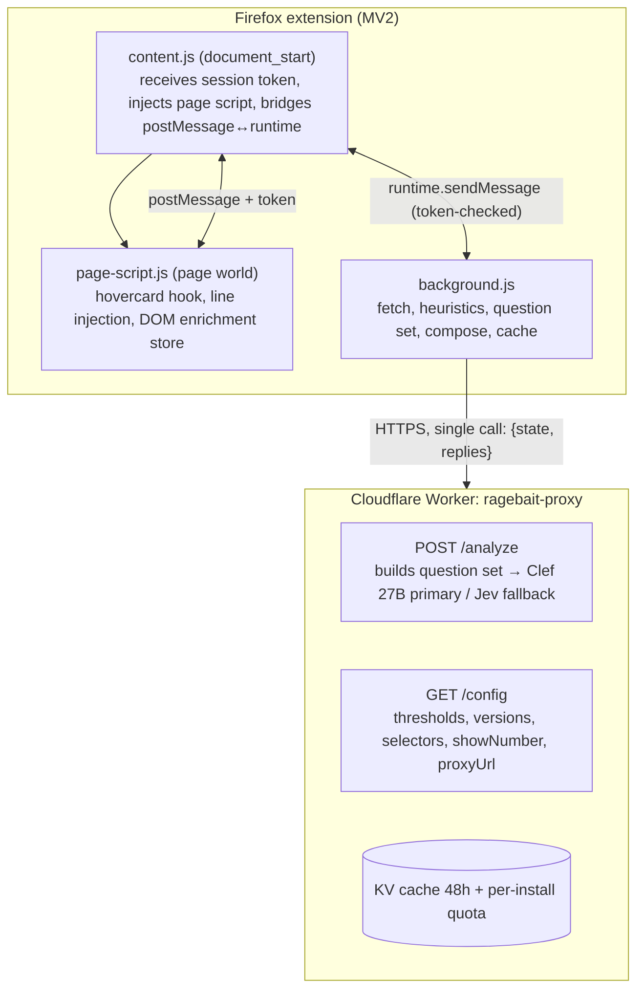

# Ragebait Detector — Plan (Design + Implementation)

Date: 2026-10-12
Revision: **v2** (multi-model council review applied; see Revision Log)
Authors: berkaykrc + opencode (brainstorming process)
Prior revision: `2026-10-12-ragebait-detector-plan.v1.md` (retained)

---

## Revision Log

v1 was reviewed by a **7-model council**: a 6-model pass (longcat-2.5, mimo-2.6-flash, step-5-preview, muse-spark-1.3, nemotron-3.5-lightning, space-bunny, big-pickle) plus a focused second pass (`ling-3.1-flash`, security/error-semantics/cache-semantics focus). `exo-free` could not be run at all — it is deprecated on this provider. The 6-model pass found 27 distinct defects; the single-model first review had found 4 blockers / 5 highs, so **the council added 4 blockers and 8 highs that one pass missed**. The ling pass was run against v1 and contributed **2 findings that survived into v2 and are now fixed** (D13, D14).

All 29 distinct findings are resolved below. The most serious were:

- No host permission for `api.fxtwitter.com` — the background cross-origin fetch is rejected at runtime, so the extension was dead on arrival
- `manifest.json` was never copied into the loaded extension root, so every lint and build step failed
- `src/page/index.js` (the esbuild page entry) was created by no task, so `dist/page.js` was never emitted
- Task 1's build step could not pass because none of the four entry points existed yet
- DOM enrichment was specified four times and implemented zero times (7/7 unanimous)
- Seven tasks carried duplicated, mutually contradictory step blocks whose second copy silently dropped required behaviour
- The session token was delivered in a DOM-readable tag while being described as spoofing protection (D13)
- The "page-1 sketch → page-2 upgrade" promise was unreachable given the `MIN_REPLIES` stop condition (D14)

### Judgment calls made during review (review these first)

| # | Decision | Rationale |
|---|---|---|
| D1 | **DOM enrichment stays in v1**, but scoped to the cheap half only: `src/page/dom-store.js` (store + merge, Task 3) and the background merge (Task 8). The **Replies-tab MutationObserver scraper is deferred to Phase 5** — the store exists and is tested, nothing populates it yet | The user deferred this to my judgement and it is outside their expertise, so here is the reasoning in plain terms. DOM enrichment is insurance against FxTwitter (the data source) dying. The *scraper* half is fragile: it depends on X's internal `data-testid` attributes, which X changes often, so it breaks for reasons unrelated to our code. The *store* half is trivial and permanent. Doing the store now and the scraper later gets the insurance without paying the maintenance cost on the fragile part. |
| D2 | **Worker owns the question set**; the extension sends `{state, replies}` only | One owner for one wire format. `buildQuestionSet` in the Worker is no longer dead code, and the extension cannot reach `worker/` across packages. |
| D3 | **Unified cache key**: local `ragebait:v1:{mv}:{fv}:{handle}`, Worker `sha256("ragebait:v1:{mv}:{fv}:{handle}")` | Satisfies the Global Constraint while giving the Worker a fixed-length KV key. Delimiters prevent boundary collisions. |
| D4 | **`showPercent` deleted**; `showNumber` from `/config` is the single authority | One gate, one name. Users cannot force it on. |
| D5 | **`fetchReplies` gains `signal`** (cancellable) and `{ok:false}` gains a `replies` field. The `onPage` streaming callback v2 briefly added is **removed** — D14 deleted its only consumer | The `replies` field on failure is what makes the `estimated` degrade path possible. Streaming was only needed for the staged render, which is gone. |
| D6 | **Band interval is half-open**: Low `[0, 0.45)`, Medium `[0.45, 0.75)`, High `[0.75, ∞)` | Removes the 0.75 overlap and is expressible from two thresholds. |
| D7 | **Worker order is cache → quota → model** (quota only consumed on a model-call miss) | A cached answer must not exhaust the user's daily quota. Also makes the quota-KV-failure stale-cache path reachable. |
| D8 | **`jsdom` added to devDependencies** | Tasks 3 and 7 assert DOM behaviour under `node --test`; without a DOM the assertions cannot run. |
| D9 | **Deferred: target-account size asymmetry, and `exclamationRatio`.** Kept and implemented: `burstRatio` (are all this account's replies crammed into one hour? a real ragebait signature, and computable from data we already hold) | Part 1 §4 listed these features but no task implemented them — a spec-vs-code gap. Rather than implement all three during a review: size asymmetry needs target-profile data the pipeline never fetches, so implementing it would mean inventing a signal. `exclamationRatio` overlaps with the rhetorical-question feature and adds a test for little signal. `burstRatio` is the one with genuine discriminative value, so it stays. |
| D10 | **Negative results are cached too, but briefly.** `result`/`estimated` → 7 days (the `estimated` TTL is 1 hour, since it was computed from degraded data); `insufficient` → 6 hours; `error` → 30 minutes; `quota` → never. A stale indicator appears once a cached entry is past 50% of its TTL, so a 6-hour-old `insufficient` never presents as fresh | The user was right: re-hovering the same account repeatedly is completely normal (scrolling a profile, comparing names), so **every** state must be cached or each hover re-hits the network. The original 7-day-only-result rule looked correct on paper but would have re-fetched every quiet account on every hover. Short TTLs keep the safety property that mattered — a false 404 cannot latch for 7 days — while still stopping the repeat-request pattern. |
| D11 | **Second annotator lives in the same JSONL** as `label2`/`annotator2` fields | Krippendorff α needs two ratings per item; a separate file doubles the collection steps. |
| D12 | **MV2 is the shipping target. The dev/CI baseline is Firefox Nightly `160.0a1`** (the version the user confirmed in use). The MV3 minimum-version question is removed from the critical path entirely: MV3 exists only for Chrome, Firefox does not need it, and stable Firefox runs the MV2 build | Resolving the `background.service_worker` floor would have blocked a Firefox-only user for a Chrome-only artifact. Since the actual goal is normal Firefox, MV3 is not worth an unresolved version dependency. Task 20 is explicitly post-v1 and optional. |
| D13 | **The session token is explicitly NOT a secret.** Renamed from "capability nonce" to session-correlation token; §3 now states the token is DOM-readable and lists the five structural controls that form the real boundary | Found by the `ling-3.1-flash` review: v1/v2 delivered the token inside `<script id="ragebait-config">`, which any same-origin script can read. Calling that "spoofing protection" was a false security claim. A page-world secret is impossible; the honest model is that the page may only *request* work, never *supply* it. |
| D14 | **Staged render is deleted entirely.** One request, one response, one line render. The only latency requirement is the **≤200ms cache hit**; cold-miss latency is unconstrained | v1's "page-1 sketch → page-2 upgrade" was unreachable (page 1 with ≥5 replies stops the loop, so there is no page 2; page 1 with <5 cannot produce a score). The user confirmed latency beyond the 200ms cache hit does not matter, so the whole staging mechanism is removed rather than patched — less protocol, no `onPage`, no `stage` field, no half-page bands. |

---

# PART 1 — DESIGN

## 1. Purpose and success criteria

A Firefox extension that shows, inside X (Twitter) user hovercards (the popout shown when hovering a username), whether that account carries a **ragebait / engagement-bait** profile. The analysis is based on the account's **replies** — the patterns in what they write under other people's tweets — not on their original posts.

Success criteria:
- Hover → **cache hit renders ≤200ms**; that is the only latency number that matters. A cold miss shows "analyzing…" until the fetch resolves, however long that takes. There is **no staged/partial render** (D14) — a band is never computed from an incomplete page. The in-flight dedupe means a second hover of the same account joins the running request instead of issuing a new one. Final line format: `Ragebait: High · %87` (color-coded band + calibrated number, number gated behind calibration)
- No paid/API-key burden for end users (developer credits via proxy; users can BYOK or fall back to heuristic-only mode)
- The user's own X session is never used to call X's internal API in v1 (ToS / account risk avoidance)
- Open source, development recorded end-to-end, distributable to anyone (AMO-signed xpi)

## 2. Locked decisions (with evidence)

| Topic | Decision | Evidence |
|---|---|---|
| Data source (primary) | FxTwitter public API: `GET api.fxtwitter.com/2/profile/{handle}/statuses?with_replies=true&count=40` + page until ≥5 qualifying replies or cursor exhaustion (cap 3 pages, `cursor.bottom` pagination) | Spike: verified on 10/12 real accounts; returns replies + target account (`replying_to.screen_name`); no auth |
| Data source (deep mode) | **DEFERRED — not in v1.** `UserByScreenName` (rest_id) → `UserRepliesTimeline` remains a Phase-5 spike, consent-gated, personal use | Verified live on 2026-10-10 with the user's session; all fields present |
| Data source (enrichment) | **Store + merge ship in v1** (Task 3 owns the store, Task 8 owns the merge); the **Replies-tab scraper that would populate it is Phase-5** (D1) — the store is a tested seam with no producer until then | X UI behavior verified |
| Dead alternatives | syndication CDN (empty), Nitter (all dead), vxtwitter (403), X GraphQL guest (blocked), `/2/search` (404) | Spike report |
| AI layer | Heuristics (always) + Clef 27B (TypeSafe-compatible endpoint, primary — verified in Task 12's Step 0; Workers AI only if a real `@cf/` model exists) + Jev $5 credit (fallback) | TypeSafe/Cloudflare docs + Turkish benchmark |
| Local model | None in this phase (savasy domain-mismatched, no ONNX build). Later: TurkishBERTweet evaluation | Architecture review |
| Display | Band + side-by-side calibrated number: `Ragebait: High · %87`. Number shown only after the held-out calibration gate (ECE ≤0.1 + high precision ≥0.9, Task 18) | User decision |
| Cache | browser.storage.local (7-day TTL) + Worker shared cache (48h); key `ragebait:v1:{modelVersion}:{featureVersion}:{lowerHandle}` (Worker: sha256 of that exact string) | Design (D3) |
| Distribution | Public GitHub + AMO "unlisted" signing with `update_url` (no public listing). **MV2 is the only shipping build**; MV3 is a post-v1, Chrome-only, best-effort shim (Task 20) | Mozilla policy. Release Firefox requires a signed xpi, which AMO issues for unlisted submissions — the same artifact serves Nightly and stable |
| License | Apache-2.0 | Consistency with Clef ecosystem |

## 3. Architecture (target)



**Firefox extension (MV2)**

- `content.js` (`document_start`): obtains the per-injection session token from background, injects the built `page.js` bundle (via `web_accessible_resources`) and the `ragebait-config` JSON tag, and owns the `window.message → runtime.sendMessage` bridge.
- `page-script.js` (page world, `SELECTORS` registry):
  - Hovercard hook: `#layers` MutationObserver, `[data-testid="HoverCard"]`, username from `[href$="/following"]` pathname.
  - Line injection (CP4T pattern, `afterend`); selector miss is a silent no-op with a console warning.
  - DOM enrichment: Replies-tab scraper feeding `dom-store.js`.
- `background.js`:
  - Data layer: FxTwitter client behind the `FxDataAdapter` seam (Task 4), with retry/backoff and abortable pagination.
  - Heuristics (lexicon + patterns + ratios), score composition (placeholder weights pending Task 18).
  - Cache: `browser.storage.local`, 7-day TTL, `result`/`estimated` only.

**Cloudflare Worker "ragebait-proxy"**

- `POST /analyze` → builds the question set from the submitted state (D2) → Clef 27B primary with Jev fallback.
- `GET /config` → thresholds, model/feature versions, `selectors`, `showNumber`, `proxyUrl`.
- KV: shared analysis cache (48h); per-install quota with daily limit (429 + degraded mode, never fail-open).
- No logging; no personal data retention.

Communication rules — **what the token is and is not:**

The per-injection token is a **session-correlation token, not a secret and not a spoofing defence.** It lives in a DOM-readable `<script id="ragebait-config">` tag, so any same-origin script (X's own bundle, a userscript) can read it; pretending otherwise would be a false security claim. It exists to bind responses to the card that requested them and to reject stale/cross-card messages.

The **actual** security boundary is structural, and every one of these is mandatory:

1. A page-world message may only **request** a score for a handle. It can never supply a band, a percent, or any rendering content.
2. The handle is re-validated against `/^[a-zA-Z0-9_]{1,15}$/`, lower-cased, deduped through the in-flight Map, and counted against the per-install daily cap **before** any network or quota-consuming work.
3. Only `loading | result | estimated | insufficient | error | quota | stale` states and numeric band enums are ever rendered, and every dynamic string is escaped (no page-supplied text reaches the DOM).
4. Worker-side: per-install quota + WAF, and the Worker never trusts a caller-supplied score.
5. The token check runs in the **extension world** (content script), never in the page bundle, because the page bundle is untrusted code.

page → content script via `window.postMessage` (origin + type allowlist + token echo); content script → background via `runtime.sendMessage`; the response path is background → content script → `postMessage` back to the page.

## 4. Data layer (design)

**Primary flow (hover):**
1. Hovercard opens → username read
2. Cache check (local only — the Worker cache is consulted by `/analyze`, not by the hover path) → if hit, render instantly (≤200ms budget)
3. Miss → FxTwitter: page until ≥5 qualifying replies or cursor exhaustion (cap 3 pages, count=40). The request resolves once; there is no intermediate render.
4. Extraction: `author.screen_name === handle && replying_to && replying_to.screen_name !== handle`
5. Error mapping: `not_found` after retries → `error` (no data, NO heuristic) · transport timeout / 429 / 5xx → `estimated` heuristic on whatever partial replies were collected · `malformed` with zero usable replies → `error`, otherwise `estimated`
6. Insufficient data (`< 5` qualifying replies after cursor exhaustion) → `insufficient` state

**Per-reply features:** text, language, target account, parent tweet ID, likes/replies/views counters, timestamp.

**Aggregate features (for heuristics + AI state):** reply count; distinct target count; target concentration (share of replies to top-3 targets); repeat replies to the same parent (conversation bombing); ALL-CAPS ratio; rhetorical-question density; hashtag density; provocation lexicon hits (TR+EN); average engagement per reply; temporal distribution (burst vs steady). **Deferred out of v1 (D9): target-account size asymmetry** — it requires target-profile data the pipeline never fetches, so implementing it would mean inventing a signal; and **exclamation density**, which overlaps the rhetorical-question feature and adds a test for little discriminative signal.

**Deep mode (NOT in v1):** §10. Query IDs are not part of the v1 `/config` contract; if the Phase-5 spike happens it introduces its own config version.

## 5. AI layer (design — implemented in Plan 2)

In the Worker proxy, **one call per profile** with parallel questions built from the submitted state:
- `is_provocative` (noul) — do the replies carry deliberate anger/provocation
- `is_engagement_bait` (noul) — engagement-farming pattern
- `targets_group_identity` (noul) — group-identity targeting
- `reply_farms_opponents` (noul) — repeated reply-farming under viral accounts
- `intensity` (score: calm / provocative / inflammatory)

`topic` (politics / religion / football / culture-war / troll / other) is **not** sent to the model — it is recorded offline as calibration-bucket metadata only. It is not part of the billable call and not part of the v1 contract.

Composition rules (in extension code): weights and thresholds explicit; band thresholds read from `/config`, defaulting to High ≥0.75, Medium [0.45, 0.75), Low [0, 0.45) — half-open, so 0.75 is unambiguously High (D6). `noul` answers arrive as objects `{noul: 0..1}` and are unwrapped (`answer.noul`) before math; noul carries no confidence field, only choice/score do. Composition formula (placeholder pending Task 18, marked as such in code): `score = Σ(w_i · noul_i) / Σ(w_present)` over present answers only (renormalized, never NaN). `intensity` does NOT multiply in v1 (recorded for calibration buckets only) to keep the formula auditable. `percent = Math.round(score · 100)`. The raw number is displayed ONLY after the held-out calibration gate is approved.

Calibration set: hand-labeling by the domain expert (user); 50-80 accounts to start (stratified: balanced across topics, OWN SIDE / OPPOSING SIDE balanced — to avoid building a "detects my opponents" model), second-annotator double-labeling recorded as `label2`/`annotator2` in the same JSONL, Krippendorff α report (computed in Task 17, target ≥0.7), precision-first thresholding on the tune split, final gate on the held-out split with Wilson CIs; growth to 300-500 later.

## 6. UI states (design)

- Format: `Ragebait: {band} · %{number}` (number gated behind held-out calibration); colors green/yellow/red
- In-flight state: "analyzing…" skeleton + AbortController (cancel when the card closes, propagated to the background dedupe entry; background work is shared and cancelled when no card needs it); cache hit renders instantly (≤200ms)
- States: `loading` · `result` (model or heuristic band) · `estimated` (heuristic-only: degraded data, AI error, or AI unavailable) · `stale` (TTL close to expiry: `fetchedAt` > 5 days on a 7-day TTL) · `insufficient` · `error` · `quota`
- Click the line → manual refresh; the click also releases and re-requests the background dedupe entry
- **Stale indicator** appears once a cached entry passes 50% of its TTL (`result` after 3.5d, `estimated` after 30min, `insufficient` after 3h, `error` after 15min) — the user is told the answer is from an older fetch rather than being shown a stale number as if it were fresh
- Settings page: backend mode (proxy / BYOK / heuristic-only), consent, quota display, misclassification report

## 7. Error handling and resilience

| Failure | Behavior |
|---|---|
| FxTwitter `not_found` after retries | `error` state ("analysis failed"), heuristics NOT run (no data) — never "insufficient data" |
| FxTwitter transport timeout / 429 / 5xx, or `malformed` with partial data | `estimated` heuristic on the partial replies collected so far (+ DOM data if present); DOM enrichment continues |
| FxTwitter `malformed` with zero usable replies | `error` state |
| Local daily profile limit reached, or Worker 429 | `quota` state: "quota exceeded — retry tomorrow", heuristic band still rendered beneath the notice |
| Clef outage/529 | Fallback call to Jev; if that fails, `estimated` on the heuristic band — **never** `error` |
| X endpoint/query ID rotation | `/config` hotfix (no AMO re-review); selector registry |
| X DOM changes | Selector registry fed by `/config` + CP4T upstream watch; if broken, no line, console warning |
| Page-world message abuse | Structural controls only (see §3): the page may request a score for a regex-validated, lower-cased, deduped, daily-capped handle; it may never supply a score or any rendered string; no page-supplied-result message type exists in the allowlist |
| XSS | Every dynamic string in the injected line is escaped/allowlisted (numeric enums + known keywords only) |

## 8. Testing strategy

- **Unit:** parser (real captured fixtures from the spike session), heuristic features, composition/thresholds/normalisation, cache TTL/keying/envelope, DOM-store merge
- **Integration:** mocked FxTwitter (recorded fixtures), mocked proxy responses (Clef/Jev shape), retry/timeout/paging behaviour
- **Calibration:** precision/recall per band, Krippendorff α, reliability diagram, ECE — tuned on the tune split, gated on the held-out split (Wilson CIs); threshold report
- **E2E:** web-ext lint on both build roots; load in Firefox; hovercard test on fixture accounts (yooksiktir, Boogie2988, karanows)
- **Manual QA matrix:** cache hit/miss, offline, quota exhaustion, FxTwitter flaky-404, transport error, DOM change simulation, <5-reply account, non-TR/EN account

## 9. Compliance, legal, distribution

- **AMO:** `browser_specific_settings.gecko.data_collection_permissions` declaration (mandatory; Task 19 Step 1 resolves the exact object against the live AMO schema before it is written, and pins it in a test) + first-run consent screen (ALL modes disclose the FxTwitter handle fetch; AI mode additionally discloses "reply texts of analyzed accounts are sent to Cloudflare for AI scoring") + privacy policy
- **GDPR:** tweet text of analysed third parties is personal data → data minimisation (only necessary replies + aggregates), no server-side retention, Cloudflare DPA, FxTwitter as sub-processor disclosure, DSAR path (mailto + doc in Task 19)
- **Defamation risk:** results shown only to the hovering user (NO public lists); "estimated, not definitive" framing; misclassification report path (mailto + template in Task 19)
- **Distribution:** GitHub Releases + AMO unlisted-signed .xpi with `update_url` so users auto-update; on your own machine, Fedora unbranded build / Nightly + `xpinstall.signatures.required=false` for unsigned persistent install (does NOT work on Release Firefox)
- **Repo layout (matches Part 2 exactly):** `src/` (extension: `content.js`, `page/`, `background/`, `ai/`, `data/`, `analysis/`, `options/`, `shared/`), `worker/` (proxy), `scripts/` (calibration tooling), `data/labeled/` (calibration set), `tests/`, `docs/`, `manifest.mv2.json` + `manifest.mv3.json` at root, `dist-mv2/` + `dist-mv3/` build roots (gitignored), CI: `.github/workflows/ci.yml` (Task 10)
- **CI:** `npm run lint` on both build roots + `npm test` (extension and worker suites)

## 10. Out of scope (YAGNI)

- **Deep mode** (`UserByScreenName` / `UserRepliesTimeline`, `x-client-transaction-id` signing) — deferred to a Phase-5 spike, not v1
- **Third AI tier** (Clef-flash 9B as a second fallback) — two tiers ship; a third is added only if both prove unreliable
- **Target-account size asymmetry** feature
- Bundled local model in this phase; multi-device sync; **Chrome support (the MV3 build is post-v1 and unverified — Firefox is the only supported browser in v1)**; mobile Firefox; scheduled auto-refresh; user account system; community list sharing

## 11. Open risks (registry)

1. FxTwitter service death / shape change → `FxDataAdapter` interface (Task 4) + DOM-enrichment store/merge (Tasks 3 + 8, awaiting the Phase-5 scraper, D1) + `/config` endpoint override; deep mode accepted risk until the Phase-5 spike
2. Calibration quality → precision-first on the tune split, held-out gate with Wilson CIs, α report (Task 17)
3. Free-tier ceiling (~10k neurons/day total) → phase plan (developer credits → pro plan / BYOK / heuristic-only); quota fail-degraded (stale cache/heuristic + 503, never fail-open unlimited)
4. X DOM/API changes → selector registry fed by `/config` (Tasks 3 + 11) + upstream watch
5. Abuse → per-install token quota + WAF; the Worker consults the cache **first** and consumes quota only when a model call is actually needed (D7), with an `x-quota-remaining` header

---

# PART 2 — IMPLEMENTATION (All Phases)

> **For agentic workers:** REQUIRED SUB-SKILL: Use superpowers:subagent-driven-development (recommended) or superpowers:executing-plans to implement this plan task-by-task. Steps use checkbox (`- [ ]`) syntax for tracking.

**Goal:** A self-contained Firefox extension (heuristic-only mode, no cloud dependency) that shows a ragebait band score in X hovercards based on the target account's replies — then extended with the AI decision-model layer (Clef/Jev via proxy), calibration, and release-ready compliance.

**Architecture:** MV2 extension, CP4T pattern: `content.js` (document_start) → `page-script` (page world) injection; pure logic in ES modules (`src/data`, `src/analysis`, `src/shared`) imported directly by Node tests; esbuild produces the loadable build roots (`dist-mv2/`, `dist-mv3/`, each containing its own `manifest.json`). Data source is the FxTwitter public API; results cached in `browser.storage.local`.

**Tech Stack:** Vanilla JS (ES modules), esbuild, `node --test` (Node 20+), jsdom (page-world tests only), web-ext. Single external runtime dependency: `api.fxtwitter.com` (HTTP, no auth).

**Spec:** Part 1 of this document.

## Global Constraints

- Firefox MV2 manifest; `browser_specific_settings.gecko.id` must be a real-domain-style id — placeholder `ragebait-detector@berkaykrc.local` is **replaced in Task 19 Step 3** and asserted by a test
- `strict_min_version: "121.0"` for the MV2 build (MV2 background pages are supported far below this). Development and CI run against **Firefox Nightly `160.0a1`**. `data_collection_permissions` (Task 19) is the only remaining version floor to verify before AMO submission; MV3's `background.service_worker` floor is **out of scope for v1** — MV2 is the Firefox target and MV3 is a post-v1, Chrome-only, best-effort build (D12)
- `permissions: ["storage"]` plus **explicit host permissions**: MV2 `permissions: ["storage", "https://api.fxtwitter.com/*"]`, MV3 `host_permissions: ["https://api.fxtwitter.com/*"]` (+ the Worker origin when added in Phase 2). Content-script match patterns do **not** authorise cross-origin `fetch`
- v1's only network target: `https://api.fxtwitter.com/*`; NO API keys, NO cloud (AI layer is Plan 2) — but the FxTwitter fetch IS an off-device disclosure and the privacy text must say so
- Reply extraction rule (Part 1 §4): `author.screen_name === handle && replying_to && replying_to.screen_name !== handle`
- 404-flakiness: at least 2 retries (1 initial + 2 retries = 3 attempts, backoff 500ms/1s); 429/5xx respect Retry-After + backoff
- Pagination: page until ≥5 qualifying replies or cursor exhaustion, cap 3 pages, `count=40`
- Bands are half-open: Low `[0, 0.45)`, Medium `[0.45, 0.75)`, High `[0.75, ∞)` — 0.75 is High
- `MIN_REPLIES = 5`; `percent = Math.round(score · 100)`
- Cache keys unified: `ragebait:v1:{modelVersion}:{featureVersion}:{lowerHandle}` locally, `sha256` of that exact string in the Worker KV (delimiters prevent boundary collisions). Never a singular `configVersion`
- `MODEL_VERSION = "h1"`, `FEATURE_VERSION = "f1"` — literal constants in `src/config.js`, injected into `createCache` (v1 has no `/config` call, so the values cannot come from the network)
- **Every state is cached, with a per-state TTL**: `result` 7d · `estimated` 1h · `insufficient` 6h · `error` 30min · `quota` never (it is a local limit, re-evaluated every hover). Re-hovering an account is normal usage, so no state may re-fetch. A false 404 therefore cannot latch beyond 30 minutes, and the stale indicator fires past 50% of TTL
- All code as ES modules; tests with `node --test`; `npm test` runs **both** `tests/` and `worker/tests/`; one commit per task
- Apache-2.0 license

## Review Focus

The five input classes most likely to bite a real user, most likely first. Each is pinned by a named test in the owning task.

1. **FxTwitter is unavailable (timeout / 5xx / 429) while partial replies exist** → `estimated` heuristic band, never `error` and never `insufficient` → Task 4 test (e), Task 8 test (c2)
2. **The hovercard closes before the analysis finishes** → the in-flight fetch is aborted, the dedupe entry is released, and no quota is consumed → Task 7 test (e), Task 8 test (h)
3. **An account with fewer than 5 replies (e.g. aynenk4nzi)** → `insufficient`, no estimate, line still renders → Task 5 test (d), Task 7 test (f)
4. **The user's network blocks `api.fxtwitter.com`** → the browser rejects the fetch; the line shows `analysis failed` with a console warning and the page is untouched → Task 2 Step 5 (host-permission assertion), Task 3 test (selector-miss no-op)
5. **A reply is in a language outside TR/EN** → the lexicon is skipped (`lexiconHits: null`), remaining features still computed, weights renormalised, a score is still produced → Task 5 test (e), Task 5 test (g)

---

### Task 1: Repo and toolchain

**Files:**
- Create: `package.json`, `esbuild.config.mjs`, `.gitignore`, `tests/smoke.test.js`
- Create (stub entries so the first build succeeds): `src/content.js`, `src/page/index.js`, `src/background/index.js`, `src/options/index.js`, `src/options/index.html`

**Interfaces:**
- Produces: `npm test` (`node --test tests/ worker/tests/`), `npm run build` (esbuild → `dist-mv2/`, `dist-mv3/`, each with `manifest.json`), `npm run lint` (web-ext lint on both roots), `npm run package`

- [ ] **Step 1: Write `package.json`**

```json
{
  "name": "ragebait-detector",
  "version": "0.1.0",
  "type": "module",
  "license": "Apache-2.0",
  "engines": { "node": ">=20" },
  "scripts": {
    "test": "node --test tests/ worker/tests/",
    "build": "node esbuild.config.mjs",
    "lint": "web-ext lint --source-dir dist-mv2 --warnings-as-errors && web-ext lint --source-dir dist-mv3 --warnings-as-errors",
    "package": "web-ext build --source-dir dist-mv2 --artifacts-dir web-ext-artifacts"
  },
  "devDependencies": {
    "esbuild": "^0.24.0",
    "web-ext": "^8.0.0",
    "jsdom": "^25.0.0"
  }
}
```

- [ ] **Step 2: Write `.gitignore`** — append `dist-mv2/`, `dist-mv3/`, `web-ext-artifacts/` to the existing entries (`node_modules/`, `*.zip`, `.env`, `.env.*`, `.DS_Store`). Build roots are generated and must never be committed.

- [ ] **Step 3: Write the five stub entry files** — each a single comment line (`// replaced in Task N`). `src/options/index.html` is a minimal `<!doctype html><meta charset="utf-8"><title>Ragebait</title><script src="options.js"></script>`.

- [ ] **Step 4: Write `esbuild.config.mjs`** — explicit named outputs so the emitted filenames match what the manifests reference:

```js
const entries = {
  content:   "src/content.js",
  page:      "src/page/index.js",
  background:"src/background/index.js",
  options:   "src/options/index.js",
};
// per target ("mv2" | "mv3"): esbuild.build({
//   entryPoints: entries, bundle: true, format: "iife",
//   outdir: `dist-${target}`, target: ["firefox121"],
//   copy: { "src/options/index.html": `dist-${target}/options.html` },
//   plugins: [ copyManifest(`manifest.${target}.json` -> `dist-${target}/manifest.json`) ]
// })
```
Both targets run on every `npm run build`; `manifest.mv3.json` is optional until Task 20 (a missing MV3 manifest is not an error before then).

- [ ] **Step 5: Write `tests/smoke.test.js`** — a `node:test` "toolchain works" test that asserts `dist-mv2/manifest.json` exists and parses.

- [ ] **Step 6: Run `npm install`** → dependencies installed.

- [ ] **Step 7: Run `npm run build`** → `dist-mv2/` and `dist-mv3/` each contain `manifest.json`, `content.js`, `page.js`, `background.js`, `options.js`, `options.html`.

- [ ] **Step 8: Run `npm test`** → PASS (the smoke test proves the manifest reached the build root).

- [ ] **Step 9: Commit** — `chore: repo + esbuild/test/lint toolchain (manifest copied into build roots)`

### Task 2: MV2 manifest, permissions, and the security bridge

**Files:**
- Create: `manifest.mv2.json`, `src/content.js`, `src/shared/security.js`, `src/shared/messaging.js`, `src/page/inject-config.js`
- Test: `tests/shared/security.test.js`, `tests/compliance/manifest.test.js`

**Interfaces:**
- Produces: `isTrustedRagebaitMessage(event, expectedOrigin, expectedToken)` → boolean (**session correlation, not a secret** — see §3 "Communication rules"); `parseScoreRequest(data)` → `{handle, token}` | `null`; `escapeHtml(str)` → string; `HANDLE_RE = /^[a-zA-Z0-9_]{1,15}$/`; `ALLOWED_MSG_TYPES = new Set(['rb:score-request','rb:score-refresh','rb:score-cancel','rb:config'])` — note there is deliberately **no** page-supplied-result type; `handleScoreRequest(handle, deps)` (defined in Task 8, mocked here)
- `src/shared/security.js` lives in `src/shared/` because BOTH the content script and the background script import it — and the trust check must run in the extension world, never in the page bundle, which is untrusted code
- The token is minted by background, provisioned to the page through the `#ragebait-config` tag, and is **documented as publicly readable**. It is not relied upon for authentication

- [ ] **Step 1: Write failing tests** — session-mismatch: `event.origin !== location.origin` → false; unknown `type` not in `ALLOWED_MSG_TYPES` → false; a token mismatch → false; **a message carrying a `result`/`band`/`percent` field is rejected outright** (the page world may never supply a score); bad schema (`type` wrong, handle not 1-15 chars, `/` in handle) → null; `escapeHtml('<script>')` → escaped text; `HANDLE_RE` accept/reject table.

- [ ] **Step 2: Run test** → FAIL (`ERR_MODULE_NOT_FOUND` for `src/shared/security.js`).

- [ ] **Step 3: Implement `src/shared/security.js`** — the three functions plus `ALLOWED_MSG_TYPES`; a message passes only if origin matches **and** type is in the allowlist **and** the token matches the one background issued for this injection **and** the payload contains no score-bearing field.

- [ ] **Step 4: Implement `src/shared/messaging.js`** — the full hop chain, in the extension world:
  `window.addEventListener("message")` → `isTrustedRagebaitMessage` (running here, in the extension world) → `browser.runtime.sendMessage({type, handle, token})` → `browser.runtime.onMessage` → response `postMessage` back with the token echoed. Cancel/refresh types address the current dedupe key and carry no handle round-trip.

- [ ] **Step 5: Write `manifest.mv2.json`** — `browser_specific_settings.gecko.id: "ragebait-detector@berkaykrc.local"` (placeholder; Task 19 Step 3 replaces it), `strict_min_version: "121.0"`, `permissions: ["storage", "https://api.fxtwitter.com/*"]` (the API origin is required for the background cross-origin fetch — content-script match patterns do not grant it), content scripts `https://x.com/*` + `https://twitter.com/*` at `document_start`, `web_accessible_resources: ["page.js"]`, `background: {scripts: ["background.js"]}`, `options_ui: {page: "options.html", open_in_tab: true}`. All paths are relative to the build root, never prefixed with `dist-`.

- [ ] **Step 6: Write the failing manifest test** — asserts (a) `permissions` contains `https://api.fxtwitter.com/*`, (b) every referenced asset path resolves to a file the build actually emits, (c) no path starts with `dist-` or `src/`, (d) `content_scripts[0].js === "content.js"`.

- [ ] **Step 7: Write `src/content.js`** — at `document_start`: `browser.runtime.sendMessage({type:'rb:config'})` → background replies with the **background-issued session token** + current settings → inject `<script id="ragebait-config" type="application/json">{"token":…,"config":…}</script>` (documented as publicly readable — it is correlation, not a secret) → inject `page.js` from the extension URL → own the `window.message` ↔ `runtime.sendMessage` bridge via `messaging.js` → forward `browser.storage.onChanged` config changes to the page.

- [ ] **Step 8: Write `src/page/inject-config.js`** — reads `#ragebait-config`, parses it once, exposes `getConfig()` and `getToken()` to the page-world modules; if the tag is missing or unparseable it returns `{token: null, config: {}}` and the page script refuses to issue requests.

- [ ] **Step 9: Run tests** → PASS.

- [ ] **Step 10: Run `npm run build` then `npm run lint`** → clean.

- [ ] **Step 11: Commit** — `feat: mv2 manifest + host permissions + session-token bridge`

### Task 3: Page entry, hovercard hook, line rendering, DOM store

**Files:**
- Create: `src/page/index.js`, `src/page/hovercard.js`, `src/page/render.js`, `src/page/dom-store.js`
- Test: `tests/page/hovercard.test.js`, `tests/page/render.test.js`, `tests/page/dom-store.test.js`

**Interfaces:**
- Consumes: `escapeHtml`, `ALLOWED_MSG_TYPES` (Task 2), `getConfig`/`getToken` (Task 2)
- Produces: `extractScreenName(followingPathname)` → string | null (`'/yoksiktir/following'` → `'yoksiktir'`); `shouldRenderLine($hoverCard)` → boolean; `buildLineMarkup(state)` → HTML string; `BAND_STYLES` → `{low, medium, high}` colour map; `SELECTORS` → `{layers, hoverCard, avatarContainer, followingLink}` (the `tweet`/`socialContext` scraper selectors are Phase-5, D1); `createDomStore()` → `{record(handle, replies), merge(apiReplies), get(handle)}`; `bootPage()` (the `src/page/index.js` entry that wires security + hovercard + render + dom-store together)

- [ ] **Step 1: Write failing tests** — `extractScreenName('/yoksiktir/following')` → `'yoksiktir'`; `'/following'` → null; `null` → null; `'/a/b/following'` → null; `buildLineMarkup({state:'loading'})` → contains "analyzing…"; `{state:'result', band:'high', percent:null}` → "Ragebait: High" + "estimated" + the `high` colour class; `{state:'estimated', band:'medium'}` → "estimated (no model)"; `{state:'insufficient'}` → "insufficient data"; `{state:'error'}` → "analysis failed"; `{state:'quota'}` → "quota exceeded"; a band value containing `<b>` is escaped; `BAND_STYLES` has exactly the three keys; selector miss → no-op + a single `console.warn`.

- [ ] **Step 2: Run test** → FAIL.

- [ ] **Step 3: Implement `hovercard.js`** — MutationObserver on `SELECTORS.layers` (childList); if an added node contains `SELECTORS.hoverCard` → wait for `div[data-testid^="UserAvatar-Container"]` (rAF poll, 500ms timeout) → username from `SELECTORS.followingLink` pathname → `render.js` inserts the line with `insertAdjacentHTML('afterend', …)` at the CP4T insertion point (3rd parent of the following anchor). Selector miss → silent no-op + `console.warn`; the page never breaks.

- [ ] **Step 4: Implement `render.js`** — `buildLineMarkup`, `BAND_STYLES`, `shouldRenderLine`.

- [ ] **Step 5: Implement `dom-store.js`** — `createDomStore()` keyed by lower-case handle. `record(handle, replies)` stores replies scraped from `SELECTORS.tweet` + `SELECTORS.socialContext`; `merge(apiReplies)` returns the union keyed by reply `id` with API replies winning on conflict; `get(handle)` returns stored replies or `null`. This is the module Part 1 §2/§11.1 promised and v1 omitted.

- [ ] **Step 6: Write failing `dom-store` tests** — record then `get` returns them; `merge` deduplicates by `id` and prefers the API copy; `get` on an unseen handle → `null`; records lacking a parent id are stored with `parentStatusId: null`.

- [ ] **Step 7: Run test** → FAIL.

- [ ] **Step 8: Implement `dom-store.js`** — the store and merge logic only. `record(handle, replies)` accepts `Reply[]` in the Task 4 shape; `merge(apiReplies)` returns the union keyed by reply `id`, API copy winning. **The Replies-tab scraper that would populate it is Phase-5 (D1)**, so in v1 `record` is called by nothing and `get` normally returns `null` — the store is a tested seam waiting for its producer, not a feature.

- [ ] **Step 9: Run test** → PASS.

- [ ] **Step 10: Implement `src/page/index.js`** — the esbuild page entry: read config/token, start the hovercard observer, create the dom-store, and register the message handlers. Without this file `dist/page.js` is never emitted (a v1 blocker).

- [ ] **Step 11: `npm run build` + commit** — `feat: page entry + hovercard rendering + DOM store`

### Task 4: FxTwitter client, reply extractor, adapter seam

**Files:**
- Create: `src/data/fxtwitter.js`, `src/data/parse.js`, `src/data/adapter.js`
- Create (fixtures): `tests/fixtures/fxtwitter-yooksiktir.json`, `tests/fixtures/fxtwitter-boogie2988.json`
- Test: `tests/data/parse.test.js`, `tests/data/fxtwitter.test.js`, `tests/data/adapter.test.js`

**Interfaces:**
- Produces: `Reply` = `{id, text, lang, targetScreenName, parentStatusId, likes, replyCount, views, createdAt}`; `extractProfileReplies(responseJson, handle)` → `Reply[]`; `fetchReplies(handle, {fetchImpl, sleepImpl, maxPages=3, count=40, signal})` → `{ok:true, replies} | {ok:false, reason:'not_found'|'network'|'rate_limit'|'malformed', replies: Reply[]}`; `FxDataAdapter` = `{name: string, fetchReplies(handle, deps): Promise<FetchResult>}`
- **Source→Reply field map (exact):** `id` ← `id`; `text` ← `text`; `lang` ← `lang`; `targetScreenName` ← `replying_to.screen_name`; `parentStatusId` ← `in_reply_to_status_id`, else `null`; `likes` ← `likes`; `replyCount` ← `replies`; `views` ← `views`; `createdAt` ← `created_timestamp`

- [ ] **Step 1: Save fixtures** — `fxtwitter-yooksiktir.json`: a `{"code":200,"results":[…],"cursor":{…}}` array containing yooksiktir's reply `"@kviciemre knkk bak kullanamıyoruz seslide amk ya"` (`author.screen_name:"yooksiktir"`, `replying_to.screen_name:"kviciemre"`, `replies:2`, `created_timestamp:1757000000`) plus mixed content (another user's reply, an original post, a record with `replying_to:null`). `fxtwitter-boogie2988.json`: a foreign-author reply + at least one Boogie2988 own reply.

- [ ] **Step 2: Write failing parse tests** — only records with `author.screen_name === handle` AND non-null `replying_to` AND `replying_to.screen_name !== handle` are returned; in the yooksiktir fixture exactly 1 record, target `kviciemre`, full text, `lang: 'tr'`, `replyCount: 2`, `createdAt: 1757000000`; empty `results`, missing `results`, null `replying_to`, missing `legacy`/`author` → partial/empty array, no exception.

- [ ] **Step 3: Run parse test** → FAIL.

- [ ] **Step 4: Implement `parse.js`** — the rule, the field map, and partial tolerance (missing optional fields → `null`).

- [ ] **Step 5: Run parse test** → PASS.

- [ ] **Step 6: Write failing fxtwitter tests** — fake `fetchImpl`: (a) first call 404 + `{"code":404}`, second 200 → `ok:true`; (b) 3× 404 → `{ok:false, reason:'not_found', replies:[]}`; (c) asserts the URL carries `count=40&with_replies=true`, that paging stops at ≥5 qualifying replies or cursor exhaustion (cap 3), and that a missing cursor terminates; (d) network throw → `{ok:false, reason:'network'}`; (e) 200 + broken JSON → `reason:'malformed'`; (f) 429 → `reason:'rate_limit'` honouring `Retry-After`; (g) 5xx → backoff then `reason:'network'`; (h) 5xx on page 2 → `reason:'network'` **with the page-1 replies still in `replies`** (this is what makes the `estimated` state possible); (i) an aborted `signal` rejects with `reason:'network'` and `replies` holding whatever was collected.

- [ ] **Step 7: Run test** → FAIL.

- [ ] **Step 8: Implement `fxtwitter.js`** — URL `https://api.fxtwitter.com/2/profile/${handle}/statuses?with_replies=true&count=40` (+ `&cursor=` from page 2 on); 404 retried twice with 500ms/1s backoff; 429/5xx respect `Retry-After` then exponential backoff; `sleepImpl` and `signal` injected. The promise resolves **once**, after pagination completes or exhausts — there is no intermediate callback (D14).

- [ ] **Step 9: Write failing adapter tests then implement `adapter.js`** — `fxtwitterAdapter` implements `FxDataAdapter`; a `domAdapter` built on the Task 3 store returns `{ok:true, replies}` from `dom-store.get(handle)` and `{ok:false, reason:'not_found', replies:[]}` when empty; a `mergeAdapters(primary, fallback)` tries primary then falls back — this is the SPOF seam (Part 1 §11.1).

- [ ] **Step 10: Run test** → PASS.

- [ ] **Step 11: Commit** — `feat: fxtwitter client (pagination + abort) + reply extractor + adapter seam`

### Task 5: Heuristic features and score composition

**Files:**
- Create: `src/analysis/lexicon.js`, `src/analysis/features.js`, `src/analysis/compose.js`, `src/config.js`
- Test: `tests/analysis/features.test.js`, `tests/analysis/compose.test.js`

**Interfaces:**
- Produces: `MODEL_VERSION = "h1"`, `FEATURE_VERSION = "f1"` (Task 6 consumes these); `computeFeatures(replies)` → `{replyCount, distinctTargets, targetConcentration, repeatParentRatio, capsRatio, exclamationRatio, rhetoricalQuestionRatio, hashtagDensity, lexiconHits, likesPerReply, burstRatio, langSupported}`; `composeScore(features)` → `{score: number 0-1, band: 'low'|'medium'|'high', heuristic: true} | {insufficient: true}`

- [ ] **Step 1: Write lexicon** (`lexicon.js`) — starter TR+EN lexicon, ≥25 entries, whole-word, case-insensitive. Turkish agglutination will under-match; the substring/stemming policy is revisited at calibration (Task 18).

- [ ] **Step 2: Write failing features tests** — `capsRatio`: "LAN BU NE" / 3 → 1.0; `exclamationRatio`: 2 of 4 replies contain `!` → 0.5; `rhetoricalQuestionRatio`: share of replies ending "?"; `hashtagDensity`: "#x #y" over 4 words; `targetConcentration`: 100% on 3 targets → 1.0; `repeatParentRatio`: same `parentStatusId` 3× → 1.0; `lexiconHits`: "amk" and "cope" → 2; `burstRatio`: all replies within one hour → 1.0, evenly spread over a day → < 0.3; `replyCount < 5` → insufficient, computation skipped.

- [ ] **Step 3: Run test** → FAIL.

- [ ] **Step 4: Implement `features.js`** — `Reply[]` → feature vector. If `lang` is outside TR/EN the lexicon is skipped (`lexiconHits: null`, `langSupported: false`) and everything else is still computed. `parentStatusId: null` records are excluded from `repeatParentRatio`'s denominator.

- [ ] **Step 5: Run test** → PASS.

- [ ] **Step 6: Write failing compose tests** —
  (a) all seven weighted features at their maximum → `score === 1.0` and `band: 'high'`;
  (b) exactly `0.75` → `high`; `0.7499` → `medium`; `0.45` → `medium`; `0.4499` → `low`;
  (c) lexicon 1, caps 1, rhetorical 1, concentration 1, and the remaining three at 0 → `(0.25+0.15+0.15+0.15)/1.00 = 0.70` → `medium` (proves zero counts as present, not absent);
  (d) `{replyCount: 4}` → `{insufficient: true}`;
  (e) `lexiconHits: null` with the other six at max → numerator `0.15+0.15+0.15+0.15+0.05+0.10 = 0.75`, denominator `Σ(w_present) = 0.75` → `score = 1.00` → `high` (renormalisation proof: the absent feature does not drag the score down);
  (f) a reply text with 12 lexicon hits normalises to 1.0, never above (normalisation proof).

- [ ] **Step 7: Run test** → FAIL.

- [ ] **Step 8: Implement `compose.js`** — documented initial weights, **marked PLACEHOLDER pending Task 18**, never enshrined:

| weight | feature | normalisation into [0,1] |
|---|---|---|
| 0.25 | `lexiconHits` | `min(1, lexiconHits / (0.5 · replyCount))` |
| 0.15 | `capsRatio` | already 0-1 |
| 0.15 | `rhetoricalQuestionRatio` | already 0-1 |
| 0.15 | `targetConcentration` | already 0-1 |
| 0.15 | `repeatParentRatio` | already 0-1 |
| 0.05 | `hashtagDensity` | `min(1, hashtagDensity / 0.25)` |
| 0.10 | `likesPerReply` | `min(1, log1p(likesPerReply) / log1p(500))` |

Sum = 1.00. `score = Σ(w_present · f_present) / Σ(w_present)` where "present" means **non-null** (zero is present). Clamp the result to `[0, 1]`. `MIN_REPLIES = 5`.

- [ ] **Step 9: Write `src/config.js`** with `MODEL_VERSION = "h1"` and `FEATURE_VERSION = "f1"`.

- [ ] **Step 10: Run test** → PASS.

- [ ] **Step 11: Commit** — `feat: heuristic features + normalised band scoring`

### Task 6: Local cache

**Files:**
- Create: `src/data/cache.js`
- Test: `tests/data/cache.test.js`

**Interfaces:**
- Consumes: `MODEL_VERSION`, `FEATURE_VERSION` (Task 5)
- Produces: `createCache({storage, now, modelVersion, featureVersion})` → `{get(handle), set(handle, result), peek(handle)}`; `TTL_BY_STATE = {result: 7*24*3600e3, estimated: 3600e3, insufficient: 6*3600e3, error: 1800e3, quota: 0}`; `STALE_AFTER_FRACTION = 0.5`; key `ragebait:v1:{modelVersion}:{featureVersion}:{lowerHandle}`

- [ ] **Step 1: Write failing tests** — set→get roundtrip returns the stored value; a record 7 days + 1 second old → `null`; a different `modelVersion` or `featureVersion` → `null`; a case-variant handle hits the same entry; corrupt JSON → `null` (no throw); a storage that throws → `null`.

- [ ] **Step 2: Run test** → FAIL.

- [ ] **Step 3: Write three more failing tests** — `set` wraps the value as `{value, fetchedAt: now(), ttlMs}` and `get` returns the **envelope**; each state's TTL is honoured independently (`{state:'insufficient'}` aged 6h → `null`, aged 5h → envelope present; `{state:'error'}` aged 31min → `null`, aged 29min → present; `{state:'result'}` aged 8d → `null`); **`quota` is never written**, so a subsequent `get` returns `null`; `peek(handle)` returns the envelope regardless of TTL so the caller can decide whether to render stale data or refetch.

- [ ] **Step 4: Implement `cache.js`** — `Map` front cache + storage adapter; `get` order memory → storage; TTL from `TTL_BY_STATE[value.state]` via injected `now()`; returns the envelope `{value, fetchedAt, ttlMs}` plus a `stale` boolean when `now() - fetchedAt > ttlMs * STALE_AFTER_FRACTION`.

- [ ] **Step 5: Run test** → PASS.

- [ ] **Step 6: Commit** — `feat: browser.storage cache (7d TTL, version-keyed, result/estimated only)`

### Task 7: Hovercard UI states (live flow) and messaging

**Files:**
- Create: `src/page/messaging.js`
- Modify: `src/page/render.js` (state machine), `src/page/hovercard.js` (AbortController + click)
- Test: `tests/page/render-states.test.js`, `tests/page/messaging.test.js`

**Interfaces:**
- Consumes: `ALLOWED_MSG_TYPES`, `isTrustedRagebaitMessage` (Task 2), `STALE_AFTER_MS` (Task 6)
- Produces: `STATE_MARKUP` covering `loading | result | estimated | insufficient | error | quota | stale`; `applyState($line, state)`; `sendScoreRequest(handle)`, `sendRefresh(handle)`, `sendCancel(handle)`, `onScoreResult(cb)`; in-flight requests aborted via `AbortController.abort()` when the card leaves the DOM, with a `rb:score-cancel` message to release the background dedupe entry

- [ ] **Step 1: Write failing tests** — loading→result transition: after `applyState` the markup contains the band and the "estimated" label; loading→estimated shows "estimated (no model)"; result→(refresh)→loading; `estimated` when the envelope's `fetchedAt` is older than `STALE_AFTER_MS` adds the stale indicator; band colour classes per band; `quota` shows "quota exceeded — retry tomorrow" **and still renders the heuristic band beneath it**; `insufficient` and `error` render their copy; a state transition for a **different handle** never mutates the previous line.

- [ ] **Step 2: Run test** → FAIL.

- [ ] **Step 3: Implement `render.js`'s state machine** — the seven states above; `applyState` is idempotent for the same state and always replaces the whole line body.

- [ ] **Step 4: Write failing messaging tests** — `sendScoreRequest` emits `{type:'rb:score-request', handle, token}`; `sendCancel` emits `rb:score-cancel`; a page-world message arriving with an unknown `type` is ignored without a `runtime.sendMessage` call; a message carrying `band`/`percent`/`result` is rejected outright; a result for an unknown handle is ignored.

- [ ] **Step 5: Run test** → FAIL.

- [ ] **Step 6: Implement `src/page/messaging.js`** — the page-world half of the bridge (Task 2's `messaging.js` is the extension-world half); plus `hovercard.js`: MutationObserver watches card removal → `controller.abort()` + `sendCancel(handle)`; clicking the line → `sendRefresh(handle)`.

- [ ] **Step 7: Write one more failing test** — card removal aborts the controller and emits exactly one `rb:score-cancel` for that handle (Review Focus #2).

- [ ] **Step 8: Run test** → PASS.

- [ ] **Step 9: `npm run build` + commit** — `feat: hovercard state machine + cancel + refresh + page messaging`

### Task 8: Background orchestration

**Files:**
- Create: `src/background/index.js`, `src/background/protocol.js`, `src/background/quota-local.js`
- Test: `tests/background/orchestration.test.js`, `tests/background/protocol.test.js`

**Interfaces:**
- Consumes: `fetchReplies` + `FxDataAdapter` (Task 4), `computeFeatures`/`composeScore` (Task 5), `createCache` (Task 6), `isTrustedRagebaitMessage`/`parseScoreRequest`/`ALLOWED_MSG_TYPES` (Task 2), `merge` (Task 3 dom-store, via the message bridge)
- Produces: `Result` = `{state: 'result'|'estimated'|'insufficient'|'error'|'quota', band?: 'low'|'medium'|'high', percent: number|null, heuristic: boolean, model?: string, fetchedAt: number}`; `handleScoreRequest(handle, deps)` → `Promise<Result>`; `MAX_DAILY_PROFILES = 200`; `DAILY_KEY = "stats:{YYYY-MM-DD}"`; `protocol.js` exports `MSG` (the same allowlist as Task 2, one source of truth) and `makeScoreResponse({requestId, result})` — a single response type, no staging (D14)

- [ ] **Step 1: Write failing tests** (fake fetchImpl/storage/messaging, end-to-end): (a) cache hit → **no** network call, result returned; (b) miss → FxTwitter 200 → features → compose → `cache.set` → `{state:'result', band, heuristic:true}`; (c) `not_found` after retries → `{state:'error'}` and heuristics NOT run (Review Focus); **(c2) 5xx on page 2 with ≥5 page-1 replies → `{state:'estimated', band, heuristic:true}`** (Review Focus #1); (c3) `malformed` with zero replies → `{state:'error'}`; (c4) `malformed` with 8 replies → `{state:'estimated'}`; (d) <5 replies → `{state:'insufficient'}`; (e) the same handle twice back-to-back → **one** network call; (f) `MAX_DAILY_PROFILES` exceeded → `{state:'quota'}` **and** the heuristic band still present; (g) a corrupt handle is rejected before any network call; (h) a `rb:score-cancel` for an in-flight handle aborts the fetch and releases the dedupe entry, so the next request for that handle starts fresh; (i) **single response**: a fetch that pages three times produces exactly **one** `makeScoreResponse` call, never an intermediate one; a response whose `requestId` no longer matches a live card is dropped. (This replaces v1's staged-emit test, which was untestable because page 1 either stops the loop or cannot produce a band.)

- [ ] **Step 2: Run test** → FAIL.

- [ ] **Step 3: Implement `background/index.js`** — message listener (session token + trust check) → local cache (`lowerHandle`) → dedupe Map (shared, cancellable, keyed by handle) → `FxDataAdapter` (FxTwitter, one request per dedupe key, `signal` wired to the dedupe entry's `AbortController`) → on completion, DOM-store merge (replies the user happened to surface while the Replies tab was open) → features → compose → `cache.set` → `final` response. Error mapping exactly as Part 1 §7: `not_found` → `error`; `network`/`rate_limit`/`malformed`-with-partial → `estimated`; `malformed`-empty → `error`; local daily limit → `quota`.

- [ ] **Step 4: Implement `quota-local.js`** — `consumeDailyProfile(storage, now, limit)` keyed by `stats:{YYYY-MM-DD}`; the counter resets when the date key changes; over-limit requests return `{allowed: false}` and never reach the network.

- [ ] **Step 5: Implement `protocol.js`** — `MSG` re-exported from `src/shared/security.js` (single source of truth) plus `makeScoreResponse({requestId, result})`; every response carries the `requestId` so the page can drop a result for a card that has since closed.

- [ ] **Step 6: Write failing protocol tests then implement the correlation rules** — two concurrent handles each get their own result; a `final` arriving for a request whose card is gone is dropped.

- [ ] **Step 7: Run test** → PASS.

- [ ] **Step 8: Run `npm run lint`, `npm test`, `npm run build`** → all pass.

- [ ] **Step 9: Commit** — `feat: background orchestration (cache + fetch + dom merge + score)`

### Task 9: Settings page

**Files:**
- Create: `src/options/index.html`, `src/options/index.js`
- Test: `tests/options/settings.test.js`

**Interfaces:**
- Produces: `loadSettings(storage)`, `saveSettings(storage, settings)`; fields: `mode: 'heuristic'|'proxy'|'byok'`, `consentAccepted: boolean`, `proxyUrl: string`, `byokEndpoint: string`, `apiKey: string`, `misclassificationEmail: string`. There is **no** `showPercent` field — the number gate belongs solely to `/config` `showNumber` (D4). `DEFAULT_PROXY_URL` is exported from `src/config.js` and pinned in Task 11 Step 3.

- [ ] **Step 1: Write failing tests** — defaults (heuristic mode, `consentAccepted: false`, `proxyUrl: DEFAULT_PROXY_URL`, empty `byokEndpoint`/`apiKey`); save→load roundtrip; corrupt record → defaults.

- [ ] **Step 2: Run test** → FAIL.

- [ ] **Step 3: Implement options page** — mode selector (heuristic active in v1, proxy and BYOK functional from Phase 2), consent text (ALL modes: "analyzed handles and reply fetches go to api.fxtwitter.com"; AI mode additionally: "reply texts of analyzed accounts are sent to Cloudflare for AI scoring"), quota/stats display (profiles analysed today / limit), and a misclassification-report mailto link.

- [ ] **Step 4: Run test** → PASS.

- [ ] **Step 5: `npm run build` + commit** — `feat: settings page (mode, consent, quota, misclassification report)`

### Task 10: Packaging, documentation, CI

**Files:**
- Create: `README.md`, `docs/qa/manual-matrix.md`, `LICENSE`, `.github/workflows/ci.yml`

- [ ] **Step 1: Write `README.md`** — description, install (dev: `npm install && npm run build`, then load the `dist-mv2/` folder as a temporary add-on in Firefox Nightly/Unbranded via `about:debugging`; `xpinstall.signatures.required=false` is only for unsigned persistent installs), privacy summary (FxTwitter in all modes, Cloudflare in AI mode), contribution guide, roadmap (Plan 2: AI layer; Plan 3: calibration; Phase 5: deep mode).

- [ ] **Step 2: Write `docs/qa/manual-matrix.md`** — cache hit/miss (+ ≤200ms hit check), offline, flaky-404 (force 3× 404 → `error`, not `insufficient`), transport error (5xx on page 2 → `estimated`), rate limit (429 → `estimated`), quota exhaustion (local → `quota` copy with the band still shown), cache-hit latency (≤200ms — the only latency requirement), hovercard-close cancellation, DOM change (break selectors → no line + console warning), <5-reply account, non-TR/EN account.

- [ ] **Step 3: Write `LICENSE`** — Apache-2.0 text.

- [ ] **Step 4: Write `.github/workflows/ci.yml`** — on push and PR: `npm ci`, `npm run build`, `npm run lint`, `npm test`.

- [ ] **Step 5: Final verification** — `npm test`, `npm run lint`, `npm run build` all pass; `npm run package` produces `web-ext-artifacts/`.

- [ ] **Step 6: Commit + tag** — `release: v0.1.0-alpha (heuristic mode)` and `git tag v0.1.0-alpha`.

---

## Phases and task map

| Phase | Tasks | Deliverable |
|---|---|---|
| 0-1: Extension core | 1-10, 10.5 | Working heuristic-only extension, installable on release Firefox |
| 2: AI layer | 11-15 | Worker proxy (Clef+Jev) + AI scoring in extension |
| 3: Calibration | 16-18 | Labeled set, reliability report, % number enabled |
| 4: Compliance + release | 19-21 | AMO submission, signed release |
| 5: Deep mode (deferred) | — | Not in v1 (Part 1 §10) |

### Task 10.5: Signed build for stable Firefox (do this as soon as Task 10 passes)

> **Why this task exists:** the user's stated goal is to use this in **normal, release Firefox**, not only Nightly. Release Firefox **refuses unsigned extensions** (`xpinstall.signatures.required` is locked to `true` and cannot be changed in about:config). There is no workaround — a signed `.xpi` is the only path. Signing is free, does not require public listing, and the *same signed file* installs on Nightly, Developer Edition and release Firefox. This task pulls the minimum signing prerequisites forward from Tasks 19/21 so development can happen on the browser that will actually be used.

**Files:**
- Create: `docs/amo-account-setup.md`
- Modify: `manifest.mv2.json`

**Interfaces:**
- Produces: a signed, auto-updating `.xpi` installable on release Firefox

- [ ] **Step 1: Create the free AMO account and get API credentials** — addons.mozilla.org → log in → **Tools → Developer → API Key**. Note the **API Key** and **API Secret**. These are stored only in your shell environment; they are never committed and never ship in the extension. AMO's own docs are the source of truth for the current UI labels — verify them when you do it.

- [ ] **Step 2: Replace the placeholder extension id** — AMO assigns the identity of a signed add-on, and a `.local` id is not acceptable for a permanent install. `browser_specific_settings.gecko.id` becomes a real id under a domain you control (e.g. `ragebait-detector@<yourdomain>`). Task 19 keeps the compliance assertions; this task supplies the value they check.

- [ ] **Step 3: Add `browser_specific_settings.gecko.update_url`** pointing at the AMO update endpoint for the **unlisted** add-on. Unlisted means: signed and installable, but not publicly listed or searchable. This is what makes future installs auto-update without a public page.

- [ ] **Step 4: Sign** — `AMO_KEY=... AMO_SECRET=... npx web-ext sign --api-key=$AMO_KEY --api-secret=$AMO_SECRET --source-dir dist-mv2 --artifacts-dir web-ext-artifacts`. The signed `.xpi` lands in `web-ext-artifacts/`. AMO may take a few minutes to process; poll the artifact directory.

- [ ] **Step 5: Install on release Firefox and verify** — `about:debugging` → This Firefox → Load Temporary Add-on is *unsigned-only*; for the signed build use **Add-ons Manager → gear → Install Add-on From File** and pick the `.xpi`. Then load x.com and hover an account with known replies.

- [ ] **Step 6: Commit** — `build: real gecko id + update_url (stable-Firefox install path)`

**If you would rather not deal with AMO during development:** stay on Nightly. On Nightly, `about:debugging` → Load Temporary Add-on → pick `dist-mv2/manifest.json` works with no signing at all, and `xpinstall.signatures.required=false` (about:config) also allows an unsigned *permanent* install on Nightly/Developer Edition/unbranded builds. That is the fastest loop while Tasks 1-10 are in flux. Run this task when the extension is good enough to keep installed.

---

---

### Task 11: Worker proxy scaffold and /config

**Files:**
- Create: `worker/package.json`, `worker/wrangler.toml`, `worker/src/config.js`, `worker/src/index.js`
- Test: `worker/tests/config.test.js`

**Interfaces:**
- Produces: `GET /config` → `{modelVersion, featureVersion, bandThresholds: {high, medium}, selectors: {...}, showNumber, proxyUrl, proxyEnabled}`; `buildConfig(env)` → config object; fetch router

- [ ] **Step 1: Write failing tests** — `buildConfig` returns the default band thresholds (high 0.75, medium 0.45) when env is absent; a `BAND_HIGH` env override changes them; `selectors` is always present with all five keys; missing env → `proxyEnabled: false`; **`DEFAULT_PROXY_URL` in `worker/src/config.js` equals the one exported by `src/config.js`** (one pinned URL).

- [ ] **Step 2: Run test** → FAIL.

- [ ] **Step 3: Write `worker/package.json`** — `{"name":"ragebait-proxy","type":"module","private":true,"scripts":{"test":"node --test tests/"}}`. Without `"type": "module"` every worker ESM test throws and Tasks 11-13 can never pass (a v1 blocker: the root `npm test` globs `worker/tests/`, so the worker must be runnable standalone too).

- [ ] **Step 4: Implement `worker/src/config.js` + `wrangler.toml`** — KV namespace binding, env vars for API keys (keys ONLY in Worker env, never in the extension), and the `selectors` block mirroring Task 3's `SELECTORS`.

- [ ] **Step 5: Run test** → PASS.

- [ ] **Step 6: Implement `worker/src/index.js`** — router: `GET /config` → config JSON, unknown route → 404, everything else → 405.

- [ ] **Step 7: Document and run `wrangler deploy`** in `docs/release.md` so `DEFAULT_PROXY_URL` is a real deployed URL; record the deployment in the release checklist (a v1 gap: nothing ever deployed the Worker, leaving `proxyUrl` undefined).

- [ ] **Step 8: Commit** — `feat(worker): scaffold + /config endpoint (+ selectors)`

### Task 12: /analyze with Clef 27B and Jev fallback

**Files:**
- Create: `worker/src/analyze.js`, `worker/src/questions.js`
- Test: `worker/tests/analyze.test.js`

**Interfaces:**
- Consumes: design §5 question set
- Produces: `POST /analyze` (body `{state, installToken}`) → `{answers, model}`; `buildQuestionSet(state)` → the 5 scored questions (4 noul + 1 intensity score); `callClef(payload, env, fetchImpl)` / `callJev(payload, env, fetchImpl)`
- **`state` schema (exact, defined here because it is the Worker-owned input):** `{handle, features: {replyCount, capsRatio, rhetoricalQuestionRatio, hashtagDensity, lexiconHits, likesPerReply, burstRatio, langSupported}, replySample: string[] (≤12 replies, trimmed to 400 chars each)}`

- [ ] **Step 1: Write `questions.js`** — exact instructions and criteria per design §5. `topic` is not sent (cost); per-topic calibration buckets are wired offline later. `buildQuestionSet(state)` derives the question payload from `state` alone — the client sends no questions (D2).

- [ ] **Step 2: Write failing tests** — mocked fetch: (a) Clef success → 200 + answers + `model: "clef"`; (b) Clef 529/5xx → Jev called, `model: "jev"`; (c) both fail → 502 `{error:"ai_unavailable"}`; (d) malformed body → 400; (e) the outbound payload carries exactly the 5 question ids with correct types and **no** `topic`; (f) noul answers arrive as `{noul:…}` objects; (g) a `state` missing `features` → 400 with a named reason.

- [ ] **Step 3: Run test** → FAIL.

- [ ] **Step 4: Implement `analyze.js`** — before any code, verify the Clef endpoint/binding (TypeSafe-compatible host vs Workers AI `ai.run`; do NOT hardcode an unverified `@cf/` model). Jev fallback to `https://api.typesafe.ai/v1/systemone` (Bearer from env), exponential backoff on 529.

- [ ] **Step 5: Run test** → PASS.

- [ ] **Step 6: Commit** — `feat(worker): /analyze with Clef 27B + Jev fallback`

### Task 13: KV shared cache and per-install quota

**Files:**
- Create: `worker/src/cache.js`, `worker/src/quota.js`
- Modify: `worker/src/index.js`
- Test: `worker/tests/cache.test.js`, `worker/tests/quota.test.js`

**Interfaces:**
- Produces: `getCachedAnalysis(kv, key)` / `setCachedAnalysis(kv, key, value, ttlHours=48)`; `checkAndConsumeQuota(kv, installToken, dailyLimit)` → `{allowed, remaining}`; cache key `sha256("ragebait:v1:{mv}:{fv}:{lowerHandle}")`; quota key `quota:{installToken}:{YYYY-MM-DD}`; `verifyInstallToken(request, env)` → boolean (HMAC-SHA256 over `{installToken}.{YYYY-MM-DD}` with the Worker secret, compared in constant time)

- [ ] **Step 1: Write failing tests** — cache roundtrip via fake KV; TTL set in seconds (`48 * 3600`); quota: first call allowed, third call with limit 2 → `{allowed:false, remaining:0}`; a different day resets; **two distinct install tokens get independent buckets** (a v1 blocker: no task minted or sent the token, so every install shared one bucket and one user's limit 429'd everyone); an invalid HMAC is rejected; quota-KV failure → fail-degraded (serve the stale cache entry if one exists, else 503 with `Retry-After`), never fail-open unlimited inference.

- [ ] **Step 2: Run test** → FAIL.

- [ ] **Step 3: Implement `cache.js` and `quota.js`** — fake-KV-injectable; cache key is `sha256` of the exact unified string `"ragebait:v1:{mv}:{fv}:{lower}"` (delimiters prevent boundary collisions, D3).

- [ ] **Step 4: Run test** → PASS.

- [ ] **Step 5: Wire into `index.js`** — `/analyze` order is **cache → quota → model** (D7): read the KV cache first (free, and it is what makes the quota-KV-failure stale path reachable), and only when a model call is actually needed consume quota, then call the model. Always return `x-quota-remaining`. A Worker 429 response is `{state:'quota'}` to the client, never a silent heuristic fallback.

- [ ] **Step 6: Commit** — `feat(worker): KV cache + per-install daily quota (cache-first order)`

### Task 14: Extension AI client

**Files:**
- Create: `src/ai/client.js`, `src/ai/map-response.js`
- Test: `tests/ai/client.test.js`, `tests/ai/map-response.test.js`

**Interfaces:**
- Consumes: `/config` (Task 11), settings (Task 9)
- Produces: `fetchConfig(proxyUrl, fetchImpl)`; `analyzeWithAi(state, {mode, proxyUrl, byokEndpoint, apiKey, installToken, proxyEnabled}, fetchImpl)` → `{band, percent, model, state?}` | `{fallback: 'heuristic'}`; `mapNoulToScore(answers, thresholds)` → `{score, band}`; `getInstallToken(storage)` → Promise<string> (generated once via `crypto.getRandomValues`, stored in `browser.storage.local`, sent as `X-Install-Token`)
- Weights (PLACEHOLDER pending Task 18): `is_provocative 0.3`, `is_engagement_bait 0.3`, `targets_group_identity 0.2`, `reply_farms_opponents 0.2`; `score = Σ(w_i · noul_i) / Σ(w_present)` over present `{noul}`-unwrapped answers; `intensity` recorded, NOT a multiplier; `percent = Math.round(score · 100)`

- [ ] **Step 1: Write failing tests** — (a) `{noul:0.9},{noul:0.8},{noul:0.2},{noul:0.1}` → `0.3·0.9 + 0.3·0.8 + 0.2·0.2 + 0.2·0.1 = 0.57` → band `medium` (the naive **unweighted** mean is `0.50`, not the weighted result); (b) all 1.0 → score 1.0 → high; (c) a missing noul answer is treated as absent and the weights renormalise, never NaN; (d) `mode 'heuristic'` → no network call at all; (e) `mode 'byok'` → calls `byokEndpoint` with the `Authorization` header; (f) `mode 'proxy'` → calls `proxyUrl` with `X-Install-Token`; (g) **Worker 429 → `{state:'quota'}` propagated to the caller** (not a silent fallback — a v1 contradiction); (h) 502 `{error:'ai_unavailable'}` → `{fallback:'heuristic'}`; (i) thresholds come from `/config`, not hardcoded.

- [ ] **Step 2: Run test** → FAIL.

- [ ] **Step 3: Implement client** — 10s timeout via `AbortController`; `/config` cached in `browser.storage.local` for 24h and refreshed on `featureVersion` change; `getInstallToken` mints and persists the token on first use.

- [ ] **Step 4: Write a contract test** — mocked `/analyze` output (including `{noul:…}` wrappers) fed into `mapNoulToScore` produces the same band the Worker-side test produces for the same input. Both ends of the wire are pinned by one fixture.

- [ ] **Step 5: Run test** → PASS.

- [ ] **Step 6: Commit** — `feat: AI client (proxy/BYOK/heuristic) + install token + response mapping`

### Task 15: Band score end-to-end + calibrated number gate

**Files:**
- Modify: `src/background/index.js` (orchestration adds the AI step), `src/page/render.js` (number display)
- Test: `tests/background/orchestration-ai.test.js`, `tests/page/render-number.test.js`

**Interfaces:**
- Consumes: `analyzeWithAi` (Task 14), `composeScore` (Task 5), `/config` `showNumber` (Task 11)
- Produces: orchestration returns `{state, band, percent, heuristic, model}`; `percent` is set ONLY when `config.showNumber` is true AND the AI path produced a score; markup shows `Ragebait: High · %87` when `percent` is present, `Ragebait: High (estimated)` otherwise

- [ ] **Step 1: Write failing tests** — AI success + `showNumber: false` → `percent: null` + "estimated" label; AI success + `showNumber: true` → `percent === 57` for a score of `0.567` (0 decimals, `Math.round(score·100)`); **`{fallback:'heuristic'}` → heuristic band + "estimated"**; **AI error / 502 → heuristic band + "estimated", never `error`** (overwriting a good heuristic band was a v1 defect); Worker 429 → `state: 'quota'` with the heuristic band retained; AI failure must never erase an existing `result` from the cache.

- [ ] **Step 2: Run test** → FAIL.

- [ ] **Step 3: Implement background** — cache → fxtwitter → features → compose → AI call → merge; render honours the single `showNumber` gate. The heuristic band is available from the compose step, but per D14 the line is not rendered until the orchestrator responds, and the AI upgrade (Phase 2) merges into that same single response.

- [ ] **Step 4: Run test** → PASS.

- [ ] **Step 5: Commit** — `feat: end-to-end AI scoring with calibration-gated number`

### Task 16: Calibration data collection

**Files:**
- Create: `scripts/collect-calibration.mjs`, `data/labeled/accounts.jsonl` (user-filled), `data/labeled/dataset.jsonl`, `data/labeled/dataset-tune.jsonl`, `data/labeled/dataset-heldout.jsonl` (generated)
- Test: `tests/calibration/collect.test.js`

**Interfaces:**
- Consumes: `fetchReplies` (Task 4), `computeFeatures` (Task 5)
- Produces: `collectDataset(accountLines, deps)` → rows `{handle, label, label2, annotator2, topic, features, replySample}`; skips handles with <5 replies; idempotent (re-running replaces rows); writes `dataset-tune.jsonl` and `dataset-heldout.jsonl` (70/30, stratified by label + topic, seeded so the split is reproducible)

- [ ] **Step 1: Write the `accounts.jsonl` format doc** — one JSON per line: `{"handle":"...","label":"ragebait|normal|ambiguous","label2":"ragebait|normal|ambiguous|null","annotator2":"...|null","topic":"politics|religion|football|culture-war|troll|other","note":"..."}`. `label2`/`annotator2` hold the second annotator's rating for the α subset and are `null` elsewhere (D11). The user fills this file (50-80 accounts, stratified, own-side/opposing-side balanced per design §5).

- [ ] **Step 2: Write failing tests** — with fake fetch (recorded fixtures): rows produced for valid accounts; a <5-reply account is skipped with a logged reason; a malformed JSONL line is skipped without a crash; re-running produces byte-identical output; the split preserves label and topic ratios; **both split files are written** (they are what Task 17 consumes — v1 never wrote them); `label2` is carried through into the dataset rows.

- [ ] **Step 3: Run test** → FAIL.

- [ ] **Step 4: Implement `scripts/collect-calibration.mjs`** — reads `accounts.jsonl`, fetches replies through the same client, computes features, writes `dataset.jsonl` **plus** the two deterministic stratified split files; rate-limited politely (500ms between accounts).

- [ ] **Step 5: Run test** → PASS.

- [ ] **Step 6: Commit** — `feat(calibration): dataset collection + stratified tune/held-out split`

### Task 17: Calibration evaluation harness

**Files:**
- Create: `scripts/evaluate-calibration.mjs`
- Test: `tests/calibration/evaluate.test.js`

**Interfaces:**
- Consumes: `dataset-tune.jsonl` + `dataset-heldout.jsonl` (Task 16), band thresholds from the Task 11 config shape, `label2`/`annotator2` for α
- Produces: `evaluate(dataset, thresholds)` → `{perBand: {precision, recall, support}, confusion, ece, reliabilityBuckets, wilsonCI, krippendorffAlpha}`; writes `docs/calibration/report-<date>.md`

- [ ] **Step 1: Write failing tests** — a synthetic dataset (20 rows, known labels, known scores) → high-band precision at/above the synthetic construction's threshold; ECE in [0,1]; the confusion matrix sums to the row totals; **Wilson CIs present** (a CI whose lower bound can fall below 0.9 is reported, not hidden); **α computed on the double-labelled subset and `null` when no row has `label2`**.

- [ ] **Step 2: Run test** → FAIL.

- [ ] **Step 3: Implement `evaluate-calibration.mjs`** — per row: compose the score plus (if AI output is available) the model probability; per-band precision/recall; reliability buckets (10 bins, predicted vs empirical); ECE; Wilson CIs; Krippendorff α (target ≥0.7, reported with the double-labelled `n`); writes a markdown report including the reliability diagram data.

- [ ] **Step 4: Run test** → PASS.

- [ ] **Step 5: Commit** — `feat(calibration): evaluation harness (precision/recall/ECE/reliability/Wilson/α)`

### Task 18: Threshold tuning and number gate flip

**Files:**
- Modify: `worker/src/config.js` (thresholds from tuning), `tests/worker` counterpart of Task 11's threshold assertion, `src/analysis/compose.js` (final weights), `docs/calibration/` report
- Test: `worker/tests/threshold-tuning.test.js`

**Interfaces:**
- Produces: `pickHighThreshold(tuneScores, tuneLabels, minPrecision=0.9)` → the lowest threshold at which high-band precision ≥ 0.9 while maximising recall **on the tune split** (algorithm: sort unique scores ascending, walk each as a candidate cut, keep those meeting the gate, return the smallest); the gate is evaluated **on the held-out split**; tuning writes the thresholds into `/config` and flips `showNumber: true` ONLY if held-out ECE ≤ 0.1 and held-out high-band precision ≥ 0.9 (Wilson CIs reported)

- [ ] **Step 1: Write failing tests** — synthetic scores where a 0.8 cut gives precision 0.92 / recall 0.5 and a 0.7 cut gives 0.85 / recall 0.7 → picks 0.8 on the tune split; a passing held-out split flips `showNumber`; a failing held-out split leaves it false even when the tune split passed; no threshold meeting 0.9 leaves it false. Also: **Task 11's default-threshold assertion is updated here** so the suite stays green after `config.js` changes (in v1 this step was missing and the suite went red).

- [ ] **Step 2: Run test** → FAIL.

- [ ] **Step 3: Implement** — precision-first selection; gate logic with explicit reasons written into the report; the final heuristic weights replace the PLACEHOLDERs in `compose.js`, and `/config` thresholds become authoritative for both the heuristic and AI paths so the two cannot diverge.

- [ ] **Step 4: Run test** → PASS.

- [ ] **Step 5: Run the full suite** → `npm test` green, including Task 11's updated assertion.

- [ ] **Step 6: Commit** — `feat(calibration): precision-first threshold tuning + number gate + final weights`

### Task 19: Compliance — AMO declaration, consent UI, privacy policy

**Files:**
- Modify: `manifest.mv2.json`, `src/options/index.html`, `src/options/index.js`
- Test: `tests/compliance/manifest.test.js`, `tests/compliance/consent.test.js`

**Interfaces:**
- Produces: `browser_specific_settings.gecko.data_collection_permissions` and `browser_specific_settings.gecko.update_url`; a real non-`.local` gecko id; consent state persisted; a first-run consent gate blocking AI mode until accepted (heuristic mode discloses the FxTwitter fetch and is never described as "nothing leaves your device")

- [ ] **Step 1: Resolve the exact AMO schema, then write the failing test** — fetch the current `data_collection_permissions` object shape and the minimum Firefox version that supports it, and **update the Global Constraints `strict_min_version`** if the floor is higher than 121. Then assert: the manifest carries a `data_collection_permissions` object matching that schema exactly; the privacy-policy `url` is present; `update_url` is set; the gecko id does not end in `.local`. Pinning the resolved schema (rather than "whatever AMO says today") is what makes the test discriminating.

- [ ] **Step 2: Run test** → FAIL.

- [ ] **Step 3: Implement the manifest changes** — replace the `ragebait-detector@berkaykrc.local` placeholder with the real id (v1 promised this and no task ever did it, which would have blocked signing), add `update_url` so unlisted installs auto-update, add `data_collection_permissions`.

- [ ] **Step 4: Write failing consent tests then implement the consent screen** — not accepted → AI mode blocked with a reason; accepted → allowed; heuristic mode always shows the FxTwitter disclosure and never claims nothing leaves the device; AI-mode text additionally covers the Cloudflare upload.

- [ ] **Step 5: Write `docs/privacy-policy.md`** — GDPR: minimisation, no retention, Cloudflare DPA + FxTwitter sub-processor, DSAR via mailto, "estimated not definitive" defamation framing, misclassification report via mailto with a template.

- [ ] **Step 6: Run test** → PASS.

- [ ] **Step 7: Commit** — `feat(compliance): data_collection_permissions + update_url + real gecko id + consent UI`

### Task 20: MV3 manifest and dual build (POST-v1, OPTIONAL — not on the Firefox critical path)

> **Not (D12):** This task exists for Chrome users only. v1 ships MV2 and is fully functional on both Nightly and release Firefox. If this task is skipped, nothing in the Firefox deliverable is affected. Do not let it block v1.

**Files:**
- Create: `manifest.mv3.json`
- Modify: `esbuild.config.mjs`, `package.json`, `.gitignore`
- Test: `tests/build/dual-manifest.test.js`

**Interfaces:**
- Produces: both manifests build cleanly into `dist-mv2/` and `dist-mv3/`, each with its own `manifest.json`; MV3 uses `background.service_worker`, `action`, the MV3 `web_accessible_resources` object syntax, and `host_permissions`; a `browser` → `chrome` fallback shim; SW-safe dedupe (the MV2 in-flight Map does **not** survive the SW lifecycle, so it is persisted or rehydrated)

- [ ] **Step 1: Verify the real Firefox MV3 floor and update Global Constraints** — `background.service_worker` support in Firefox landed well after 121; check the current requirement, then set `strict_min_version` in `manifest.mv3.json` accordingly. Do not ship an MV3 build whose floor is unverified.

- [ ] **Step 2: Write the failing test** — the build produces both dist roots with the correct manifest inside each; the manifests differ in `background` vs `background.service_worker`, `action`, `web_accessible_resources` syntax, and `host_permissions`; the MV3 manifest carries the same `data_collection_permissions` and `update_url` as the MV2 one; an in-flight request survives an SW restart or fails gracefully (no orphaned promise).

- [ ] **Step 3: Run test** → FAIL.

- [ ] **Step 4: Implement** — `manifest.mv3.json` + build split + `browser`→`chrome` fallback + SW-safe dedupe, and **update `package.json` scripts** so `lint` covers `dist-mv2` **and** `dist-mv3` (in v1 the lint script still pointed at the old single `dist/` root, so every lint step after Task 20 was dead).

- [ ] **Step 5: Run test** → PASS; `npm run lint` clean on both.

- [ ] **Step 6: Commit** — `feat: MV3 manifest + dual build (Firefox MV2 primary)`

### Task 21: Release — signing and distribution

**Files:**
- Create: `docs/release.md`
- Modify: `README.md` (install section)

- [ ] **Step 1: Write `docs/release.md`** — `npm run build` → `npm run package` → `web-ext sign --api-key=$AMO_KEY --api-secret=$AMO_SECRET` (keys from the user's AMO account, never committed) → signed xpi → GitHub Releases; unlisted channel with `update_url`; dev-install note (Nightly/Unbranded only). Also the Worker deployment step from Task 11 Step 7.

- [ ] **Step 2: Update `README.md`** — user-facing install from GitHub Releases + privacy summary (FxTwitter in all modes, Cloudflare in AI mode) + roadmap.

- [ ] **Step 3: Final full verification** — `npm test` (both suites), `npm run lint` (both build roots), `npm run build`, and `node scripts/evaluate-calibration.mjs` runs on the current dataset.

- [ ] **Step 4: Commit + tag** — `release: v1.0.0` and `git tag v1.0.0`.

---

## Appendix A — Session evidence (self-contained; no chat needed)

### A.1 FxTwitter public API (primary data source)
- `GET https://api.fxtwitter.com/2/profile/{handle}/statuses?with_replies=true&count=40`
- Pagination: response `cursor.bottom` → `&cursor=<value>` (page 2+)
- Reply filter: `author.screen_name === handle && replying_to && replying_to.screen_name !== handle`
- Response shape: `{code, results: [...], cursor: {top, bottom}}`; reply fields: `text`, `lang`, `author.screen_name`, `replying_to.screen_name`, `likes`, `replies`, `views`, `created_timestamp`
- Flaky 404s for existing accounts → retry 2-3×
- Doc'd rate limit 1000 req/min/IP; no auth
- Cross-origin `fetch` from the background page **requires an explicit host permission** for this origin (Global Constraints)

### A.2 X internal GraphQL (deep mode — DEFERRED, not in v1)
- `UserByScreenName`: `/i/api/graphql/AMIBMjtxEEATh4z8V9GtRg/UserByScreenName?variables={"screen_name":...}` → `data.user.result.rest_id`
- `UserRepliesTimeline`: `/i/api/graphql/X9Te-FyiGcoV2qNrnx9w3w/UserRepliesTimeline` → `data.user.result.timeline.timeline.instructions[].entries[].content.items[].item.itemContent.tweet_results.result`; reply fields: `legacy.full_text`, `legacy.in_reply_to_screen_name`, `legacy.lang`, `core.user_results.core.screen_name`; skip injected modules via `clientEventInfo.details.timelinesDetails.injectionType === "RankedOrganicTweet"`
- Headers: public bearer token, `x-csrf-token` from `ct0` cookie, `x-twitter-auth-type: OAuth2Session`, `credentials: 'include'`; the real client also sends `x-client-transaction-id`
- **Not exercised by any v1 task.** Requires its own Phase-5 spike, its own config version, and explicit consent (Part 1 §10)

### A.3 Clef / Jev API contract (identical shape)
- `POST {base}/v1/systemone` — Jev base `https://api.typesafe.ai`, model `jev-latest`; Clef via TypeSafe-compatible endpoint (verify exact host/model in Task 12 Step 4 — do NOT assume a `@cf/cloudflare/clef` path exists; Workers AI only if a real `@cf/` model/binding is confirmed)
- Body: `{state, model, questions: {id: {type: "noul"|"choice"|"score", instructions, criteria}}}` — built by the Worker from `state` (D2)
- Answers: noul → `{noul: 0..1}` (NO confidence; unwrap with `answer.noul` before math) → choice → `{choice, probabilities, confidence}`; score → `{score, legend, probabilities, confidence}`
- Errors: 401/422/429/529 → backoff; Jev $5 credit; Clef free tier ~10k neurons/day (~0.46M input tokens on 27B) TOTAL across users. Both tiers failing → 502 `ai_unavailable` → the extension renders the heuristic band as `estimated`, never `error`
- Turkish benchmark (community): Clef 27B 93.8% > Jev 92.9% > Clef-flash 84.7%

### A.4 Hovercard injection (CP4T-verified pattern)
- Repo: github.com/insin/control-panel-for-twitter (MIT) — selectors: `#layers` observer → `[data-testid="HoverCard"]` → wait `div[data-testid^="UserAvatar-Container"]` (rAF poll 500ms) → username from `[href$="/following"]` pathname → line inserted after the 3rd parent of that anchor via `insertAdjacentHTML('afterend', …)`
- Two-world split: content.js (document_start) → page script via `web_accessible_resources`; `postMessage` bridge (page↔content) and `runtime.sendMessage` bridge (content↔background), both token-checked, with the token treated as correlation only
- MV2 viable on Firefox AMO (no deprecation); MV3 floor verified in Task 20 Step 1

### A.5 Calibration corpus (to be filled by domain expert)
- `data/labeled/accounts.jsonl`: `{"handle","label","label2","annotator2","topic","note"}` — 50-80 accounts to start, topic-stratified, own-side/opposing-side balanced; `label2`/`annotator2` present for the double-labelled subset → Krippendorff α in Task 17, target ≥0.7
- `scripts/collect-calibration.mjs` writes `dataset.jsonl` **and** the seeded 70/30 stratified `dataset-tune.jsonl` / `dataset-heldout.jsonl` (Task 16)

### A.6 Verified arithmetic (spot-checks an implementer can re-run)
- Heuristic weights: `0.25 + 0.15·4 + 0.05 + 0.10` = 0.25+0.60+0.15 = **1.00**
- "Four features max, rest zero" (lexicon, caps, rhetorical, concentration = 1; repeatParent, hashtag, engagement = 0): numerator `0.25+0.15·3 = 0.70`, denominator `Σ(w) = 1.00` → **0.70** → `medium`
- Lexicon absent, other six max: numerator `0.15·4 + 0.05 + 0.10 = 0.75`, denominator `Σ(w_present) = 0.75` → **1.00** → `high`
- AI weights: `0.3·0.9 + 0.3·0.8 + 0.2·0.2 + 0.2·0.1` = 0.27+0.24+0.04+0.02 = **0.57** → `medium`; the unweighted mean is **0.50**
- Retries: 1 initial + 2 retries = **3 attempts**, matching the "3× 404 → `not_found`" test and the QA matrix
- Quota: limit 2 → call 1 allowed (remaining 1), call 2 allowed (remaining 0), call 3 → 429 remaining 0